# TRDP2 — Limited-angle CT reconstruction generalization

TRDP2 is [Md Zunayedul Islam](https://github.com/zunaaaaayed)'s research project
on Gaussian-based CT reconstruction across limited-angle acquisition configurations
and reconstruction uncertainty. This repository is maintained for TRDP2 research and
experiments; it is not the official R²-Gaussian project or an upstream contribution.

The reconstruction implementation originates from
[R²-Gaussian](https://github.com/Ruyi-Zha/r2_gaussian) by Ruyi Zha and collaborators.
TRDP2 adds acquisition-controlled experiments, reproducibility checks, guarded
execution, evaluation, and research protocols. Original authorship, commit history,
and license notices are retained.

## Research objective

Develop and evaluate uncertainty-aware reconstruction under missing angular
coverage and controlled noise. Settings should transfer across acquisition
orientations, spans and held-out deformations. The current synthetic dataset is
one worm in different shapes; independent-specimen generalization is a longer-term
objective requiring additional data. Each scan has its own reconstruction.

TV tuning and geometry-dependent regularization are historical research directions.
The latter's effectiveness and novelty remain unverified. Completed chest results
are preserved as baseline evidence.

Documentation policy: this README accumulates detailed weekly findings, results
and plots; experiment READMEs own their plans, findings, outputs and interpretations.
[NEXT_WEEK.md](NEXT_WEEK.md) contains only the current weekly summary and next-week plan.

## Current dataset direction

As of 12 October 2026, the dataset supplied by co-supervisor **Ms. Anna-Louise Brun**
is the selected data source for subsequent work. The raw `sino_selected.zip`
archive and its checksum are retained locally; see the
[dataset handoff](docs/SUPERVISOR_DATASET.md) for intake status. The earlier LIDC-IDRI
expansion is deferred. Existing pilot and TV results remain evidence for their
original data convention and do not establish performance on the new dataset.

## Weeks 4–5 combined — worm uncertainty (work completed 12–21 October 2026)

Weeks 4 and 5 are reported together because the intervening supervisor meeting
was postponed. Work began on **12 October 2026**. The report must be sent on
**22 October 2026**, ahead of the presentation on **23 October 2026**.
**Experimental work for Weeks 4–5 is closed as of 21 October 2026.**
The dated entries below preserve the development history; the closing assessment
records the final findings and next-week priorities.

Branch: `experiment/worm-uncertainty`. The current objective is uncertainty under
missing angles and controlled noise. The synthetic parallel-beam TIFFs contain
(z, angle, detector) = (510, 100, 310), with 1 µm sampling and 100 angles over
[0°,180°). Files are deformations of **one worm**, not independent specimens.
Physical projection normalization and matching voxel density targets remain
unresolved; all current calculations use stored projection units.

Completed CPU development work:

- Reproducible Gaussian-noise preparation with hashes, angle masks and overwrite
  protection; immutable source TIFFs.
- Analytic off-centre disk check and one full-angle filtered-backprojection (FBP)
  slice. This validates the scikit-image path, not the Gaussian/TIGRE backend.
- 21 paired FBP runs on worm_004, z=255: spans 180°, 120°, 90°; noise standard
  deviations 0%, 1%, 5% of the development slice RMS (6210.1146 stored units).
  Noisy conditions each use seeds 0, 1, 2, shared across angular masks.
- Seven CPU tests pass, including withheld-view isolation for FBP and SART. Missing views contribute
  zero on the full angle grid, retaining the original angular quadrature weights.

Seed-zero projection relative L2 errors against clean data:

| Span | Noise sigma / development RMS | Measured-view error | Withheld-view error |
|---|---:|---:|---:|
| 180° | 0% | 4.28% | — |
| 120° | 0% | 21.75% | 80.72% |
| 90° | 0% | 27.62% | 86.32% |
| 180° | 1% | 4.44% | — |
| 120° | 1% | 21.78% | 80.72% |
| 90° | 1% | 27.64% | 86.33% |
| 180° | 5% | 7.36% | — |
| 120° | 5% | 22.55% | 80.74% |
| 90° | 5% | 28.24% | 86.34% |

These are projection discrepancies, **not voxel errors or uncertainty calibration**.
The large missing-view errors expose the weakness of zero-filled limited-angle
FBP. Values use the same numerical reprojection operator and one development
slice. The three-realization standard-deviation maps measure noise response only;
they do not capture missing-wedge ambiguity or provide posterior intervals.

Local outputs: `output/worm_uncertainty/paired_fbp_20261017/` contains arrays,
checksummed results and a reconstruction comparison with a shared intensity scale.
See [the detailed protocol](experiments/worm_uncertainty/README.md).

Reproduce from the repository root (choose a fresh output directory):

```bash
source ~/espaces/travail/trdp2/tools/miniforge3/etc/profile.d/conda.sh
conda activate trdp2-r2
export MPLCONFIGDIR=/tmp/cache-mdzislam/matplotlib
python -B -m unittest discover -s experiments/worm_uncertainty -p 'test_*.py' -q
python -B experiments/worm_uncertainty/compare_noise.py \
  --source ../worm_data/worm_004_gt.tiff \
  --output output/worm_uncertainty/paired_fbp_repeat
```

### Reading the scales: what counts as good?

| Plot or score | Meaning of increasing values | How to judge it |
|---|---|---|
| Density / reconstruction brightness | More reconstructed material density | Neither bright nor dark is inherently better; compare structure and values with a valid reference |
| Absolute error, bias, RMSE, relative projection error | Larger discrepancy from reference | Lower is better; zero is ideal. No application-specific acceptable threshold is established |
| Noise standard deviation | Less repeatability across measurement-noise draws | Low values can coexist with systematic error; assess alongside actual error |
| Posterior standard deviation | Less certainty under the assumed model | Neither high nor low alone establishes quality; check calibration and interval width |
| Empirical coverage of nominal 95% intervals | More reference values inside intervals | Near 95% is the target; below suggests intervals miss too often, above can indicate conservatism |
| Interval width | Less precise estimates | Narrower is useful only when coverage remains adequate |

Image brightness is not a pass/fail score. We label units, common display ranges,
and saturation where applicable. Error thresholds need a scientific measurement
tolerance; none has been supplied yet. Foreground scores avoid dilution by empty
background. No figures below demonstrate biological measurement accuracy.

### Reconstruction plots and iterative baseline

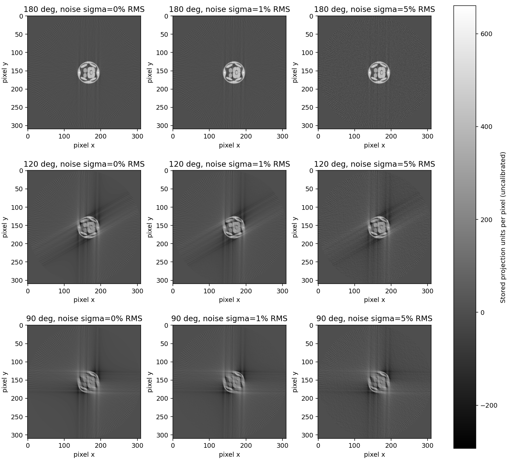

**FBP:** shrinking angular coverage causes directional streaks and loss of interior
structure; added noise introduces finer fluctuations. All nine panels share one
intensity scale. These are reconstructions, not ground-truth images.

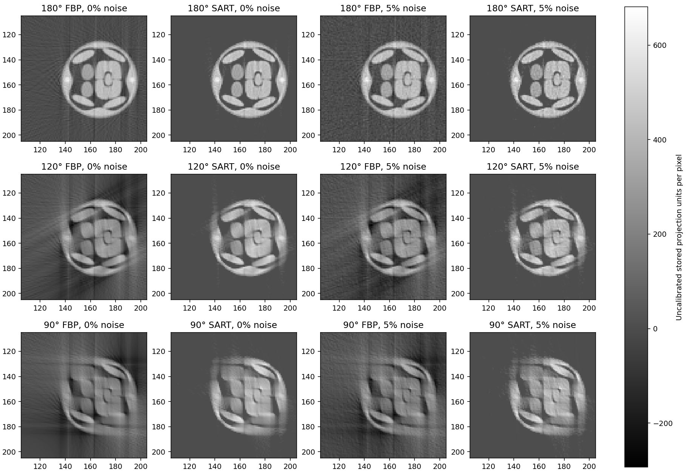

**Iterative baseline:** SART uses only measured views, a zero initializer, 10 fixed
sweeps, relaxation 0.15, nonnegativity and circular support. The fixed crop
[105:205,105:205] and shared scale make interior differences visible. FBP has no
nonnegativity constraint, so this compares complete baselines, not an isolated
solver change. Neither method uses TV here.

| Span | Noise sigma / RMS | FBP withheld error | SART withheld error |
|---|---:|---:|---:|
| 120° | 0% | 80.72% | 14.38% |
| 120° | 5% | 80.74% | 14.39% |
| 90° | 0% | 86.32% | 19.49% |
| 90° | 5% | 86.34% | 19.48% |

Errors are relative L2 against clean withheld projections, seed zero. SART improves
this development diagnostic substantially; larger missing wedges still leave more
error. Similar clean/noisy scores do not prove noise robustness: only one slice
and one realization were compared. At full coverage, SART measured-view errors
are 3.08% clean and 3.67% at 5% noise, versus FBP 4.28% and 7.36%.
No voxel ground truth or calibrated uncertainty is available. SART and evaluation
Radon discretizations differ. Settings were fixed before this run, with no stopping
or fitting based on withheld values.

Accepted outputs: `output/worm_uncertainty/sart_20261017_v2/`. The superseded
attempt record documents the support warning; v2 enforces circular support after
each sweep. Seven tests pass, including withheld-value isolation for SART.
Figure and input provenance: [plot records](docs/figures/worm_uncertainty/provenance.json).

After the paired FBP command above, reproduce with:

```bash
python -B experiments/worm_uncertainty/compare_sart.py \
  --input output/worm_uncertainty/paired_fbp_repeat \
  --output output/worm_uncertainty/sart_repeat
```

Next: evaluate uncertainty against appropriate references. Resolve simulator scaling and
orientation, group related deformations before freezing splits, and separate
noise sensitivity from reconstruction ambiguity. No GPU training is queued; the bounded slab pilot below has completed.

### Known-target phantom: noise variability versus reconstruction error

A 64×64 structured phantom contains an elliptical body, distinct density regions,
small inclusions and a textured interior patch. We ran 63 fixed-budget SART
reconstructions: three clean controls and 20 noise realizations for each of
180°, 120° and 90° coverage. All masks share the same full-grid noise draws.
Gaussian sigma is 5% of full clean phantom sinogram RMS; seeds are 0–19. The
solver retains 10 sweeps, relaxation 0.15, zero initialization, nonnegativity and
circular support. Known target values are used only to evaluate the reconstructions.

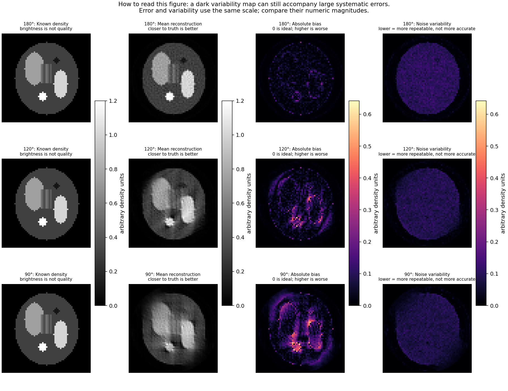

Truth and reconstructed means share a density scale; absolute bias and noise
standard deviation share a second scale. Density units are arbitrary. “Bias” here
is the error of the empirical mean over 20 noise draws, not an exact population
expectation. Noise standard deviation uses the sample estimator (ddof=1).

| Coverage | Clean foreground RMSE | Noisy foreground RMSE | Empirical bias RMSE | Mean noise SD | Squared bias / total MSE |
|---|---:|---:|---:|---:|---:|
| 180° | 0.0355 | 0.1119 | 0.0460 | 0.1033 | 16.9% |
| 120° | 0.0879 | 0.1272 | 0.0918 | 0.0889 | 52.1% |
| 90° | 0.1274 | 0.1510 | 0.1280 | 0.0808 | 71.8% |

**Finding:** shrinking coverage increases actual error and empirical bias while
noise variability decreases for this fixed-budget solver. At 90°, squared bias
accounts for 71.8% of foreground MSE; 18.6% of foreground pixels have mean error
larger than twice their noise SD (32.9% at boundaries). That threshold is a
descriptive diagnostic, not a confidence-interval coverage claim. A low-variability
map can therefore miss systematic reconstruction error.

This is one controlled development phantom with matched numerical projection
physics. Boundary/interior/texture masks are reference-derived diagnostics. The
noise trend can depend on the solver and fixed sweep count (fewer views also mean
fewer per-view updates); it is not a universal law. No posterior inference or
calibration has yet been implemented. The empirical MSE decomposition is checked
to numerical precision using population variance over the finite ensemble.

Outputs: `output/worm_uncertainty/phantom_variability_20261017_v2/`; tracked
[metrics and provenance](docs/figures/worm_uncertainty/phantom_variability.json).
Nine current CPU tests pass, including a test that detects constant biased
reconstructions with zero ensemble variance.

```bash
python -B experiments/worm_uncertainty/phantom_variability.py \
  --output output/worm_uncertainty/phantom_variability_repeat
```

Next: use the known-target setup to evaluate an uncertainty model that accounts
for poorly constrained reconstruction directions. Test calibration on separate
phantoms/acquisitions and sensitivity to prior assumptions before worm transfer.

### Exact Bayesian reference: uncertainty and calibration

We added a small **linear Gaussian reference**, using a 24×24 resized development
phantom and an explicit parallel-beam projection matrix. This establishes a
tractable uncertainty baseline before any Gaussian-splatting adaptation. The
model is y = Ax + noise, with known Gaussian noise sigma (5% of full phantom
sinogram RMS), and an independent zero-mean Gaussian prior of standard deviation
tau. The exact posterior is:

`C = inverse(AᵀA / sigma² + I / tau²)`, `mean = C Aᵀy / sigma²`.

The three fixed prior scales (0.3, 1, 3) are sensitivity probes; none is selected
as best from these development results. All geometries share 50 noise draws.
The matrix reproduces the direct projector within 1e-10, and removing views must
increase posterior marginal variance for fixed prior/noise settings.

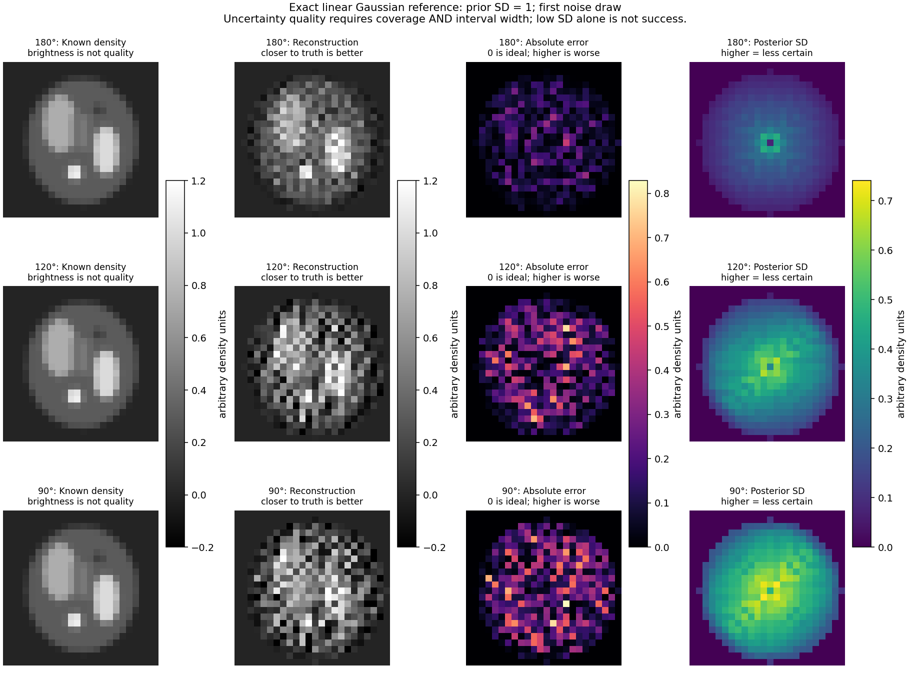

**Read this plot:** density brightness measures material value, while darker error
means closer to truth. Higher posterior SD means the model is less certain.
The error and SD columns have separate numeric ranges; do not compare colors
between them. Density panels use [-0.2, 1.2], with out-of-range display values
saturated; metrics retain all values. The independent Gaussian prior allows
negative density and is only a mathematical reference. Shown: prior SD 1 and the
first noise realization. This coarser model is not a controlled accuracy comparison
with the earlier SART experiment.

| Coverage | Foreground RMSE | Mean posterior SD | Nominal 95% empirical coverage | Mean interval width |
|---|---:|---:|---:|---:|
| 180° | 0.1514 | 0.1673 | 96.79% | 0.6557 |
| 120° | 0.2546 | 0.3462 | 98.80% | 1.3569 |
| 90° | 0.3013 | 0.4532 | 99.28% | 1.7764 |

**Finding:** posterior SD grows as angular coverage shrinks. At 90°, the mean
interval width is 1.776 density units, compared with the phantom's designed
0–1.2 density range. High coverage here comes with limited precision; it is not
proof of a useful quantitative reconstruction.

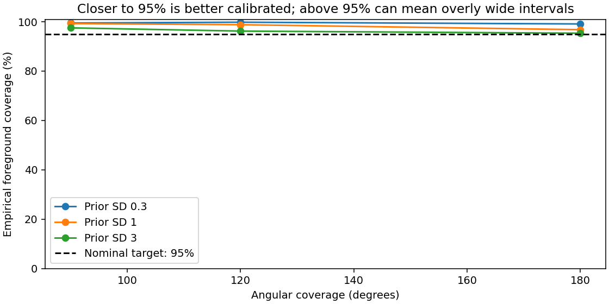

**Read this plot:** the dashed 95% line is the nominal target; proximity to it
matters, rather than maximizing coverage. On this fixed structured phantom,
coverage ranges from 95.36% to 99.81% across prior/geometry choices. A separate
model-consistency check draws 200 objects from the assumed prior and their noisy
measurements; coverage is 94.84–95.11%, consistent with the expected model behavior.
That check verifies behavior under the assumed model; it does not establish
calibration on worm data. Pixels are correlated, and these are not independent
subject-level statistics.

This reference captures uncertainty conditional on a simple prior and known noise.
It leaves prior misspecification, physical-model mismatch, positivity and unseen
shape transfer unresolved. Next: freeze a calibration protocol on separate
phantoms and test structural priors and measurement-model mismatch. The worm
simulator's scaling remains an independent question.

Local output: `output/worm_uncertainty/bayes_linear_20261017/`. See
[full metrics and provenance](docs/figures/worm_uncertainty/bayes_reference.json).
Twelve current tests pass, including a scalar posterior check, preservation of
prior variance in an unmeasured direction, and covariance growth after view removal.

```bash
OPENBLAS_NUM_THREADS=1 OMP_NUM_THREADS=1 python -B experiments/worm_uncertainty/bayes_linear.py \
  --output output/worm_uncertainty/bayes_linear_repeat
```

### Native 3D Gaussian worm slab — first integration pilot

The combined Weeks 4–5 work now includes a native GPU parallel-beam Gaussian
baseline. Analytic checks use three off-centre anisotropic 3D Gaussians at four
angles: projection relative L2 error is at most 0.0213%, voxel-query error is
0.1084%, and a density finite-difference gradient agrees within 0.0021%. Position,
scale, rotation and density gradients are finite. These checks validate the native
adapter against analytic Gaussian integrals, not the supervisor's simulator.

The worm pilot uses eight contiguous slices, z=252:260, all 100 clean angles,
1 µm sampling, 1,500 Gaussians and 300 Adam updates. Initialization samples positive
FBP values; positions, scales, rotations and densities are optimized with fixed
Gaussian count. No TV or posterior uncertainty is used. All fitting and
initialization data are measured full-angle projections.

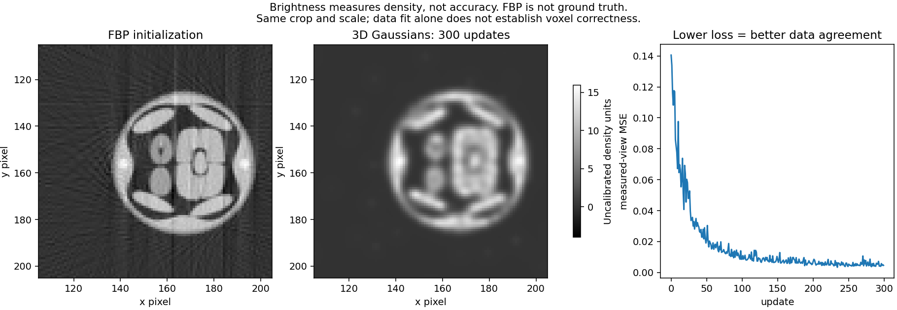

**Read this plot:** the first two panels share a scale and spatial crop; brightness
represents an uncalibrated reconstruction value, not quality. FBP is an initializer,
not ground truth. Lower measured-view MSE is better data agreement, but the curve
visits different angles and does not measure voxel error. Each displayed slice
is local z=4 (source z=256). The 3D Gaussian model covers all eight slices.

| Full-angle projection relative L2 discrepancy | Value |
|---|---:|
| Initial Gaussian representation | 38.38% |
| After 300 updates | 6.85% |

The reduction verifies a functioning optimization path; it does not establish
convergence, missing-wedge recovery or density accuracy. Every angle was fitted,
so there is no held-out score. Values are normalized by this development slab's
projection RMS (6180.27545), with scene coordinate spacing 2/310. Physical
projection normalization remains unresolved.

The native parallel renderer assumes a square normalized field of view. The
adapter keeps a 310×310 detector canvas and applies loss only to rows 151:159,
which represent the observed slab. Unobserved rows never become artificial zero
measurements. Detector u=x*cos(theta)-y*sin(theta), v=z and symmetric half-pixel
centres are explicit assumptions awaiting simulator confirmation. No inherited
source or CUDA file was changed.

[Native correctness results](docs/figures/worm_uncertainty/native_parallel_checks.json)
and [slab result/provenance](docs/figures/worm_uncertainty/gaussian_slab.json).
Local complete arrays and Gaussian parameters are under
`output/worm_uncertainty/gaussian_slab_20261017/`. The parameter export is not an
exact-resume optimizer checkpoint. Fifteen current CPU tests pass.

On a GPU workstation, after environment activation, use fresh destinations:

```bash
python -B experiments/worm_uncertainty/native_parallel.py \
  --output output/worm_uncertainty/native_parallel_repeat
python -B experiments/worm_uncertainty/fit_gaussian_slab.py \
  --source ../worm_data/worm_004_gt.tiff \
  --output output/worm_uncertainty/gaussian_slab_repeat --execute
```

Next: establish fixed-budget limited-angle slab comparisons with measured-only
initialization and held-out projection evaluation, then validate a conditional
posterior over Gaussian densities on a known 3D phantom. Uncertainty in Gaussian
positions, shapes and model count will initially remain outside that approximation.

### Limited-angle Gaussian baselines and conditional density posterior

The fixed [development protocol](experiments/worm_uncertainty/slab_protocol_v1.json)
was recorded before execution: the same eight-slice slab, 1,500 Gaussians, 1,000
updates, seed zero and no densification. Angular spans are 180°, 120° and 90°,
all starting at 0°. Clean and 5% Gaussian-noise cases share settings; noisy cases
share the same full-grid realization (seed 1701). Initializers and optimization
use measured projections only. Missing views are zero-filled for FBP quadrature,
never supplied as measured loss targets. Final iteration is fixed without
held-out stopping or tuning. Equal update counts imply different numbers of
passes through measured views.

Normalization is frozen from the earlier full-angle development slab (RMS
6180.27545). Consequently, these are development withholding diagnostics, not
blind final-test results or independent-specimen generalization.

| Coverage | Added noise / frozen RMS | Measured-view error | Withheld-view error |
|---|---:|---:|---:|
| 180° | 0% | 4.70% | — |
| 120° | 0% | 4.76% | 13.46% |
| 90° | 0% | 4.49% | 16.83% |
| 180° | 5% | 4.92% | — |
| 120° | 5% | 4.87% | 13.36% |
| 90° | 5% | 4.50% | 17.79% |

Errors are relative L2 against clean projections; **lower is better, zero is ideal**.
The larger missing wedge has higher withheld error despite similar measured-view
agreement. One slab and one noise draw cannot establish robustness. These scores
are not voxel reconstruction errors, and the earlier single-slice SART results
have different sampling and budgets, so they are not a matched method comparison.

#### First conditional posterior: a calibration failure worth preserving

For each noisy fit we freeze positions, scales, rotations and Gaussian count,
then infer all 1,500 density amplitudes. Continuous analytic Gaussian ray
integrals define a linear matrix B. With known normalized noise sigma=0.05 and
a fixed independent zero-mean Gaussian density prior of SD=10:

`C = inverse(BᵀB / sigma² + I / 10²)`

`density_mean = C Bᵀy / sigma²`

Only measured rows contribute to these equations. Voxel and latent projection
variances use the full covariance, `b C bᵀ`; noisy predictive variance adds
`sigma²`. This is an exact linear Gaussian calculation **conditional on plug-in
geometry learned from the same measurements**. It omits geometry/model-selection
uncertainty. Analytic projections differ from the native rasterizer by at most
0.0875% on these fitted models (small truncation differences). The Gaussian prior
allows signed amplitudes: 28.3–30.4% of posterior mean amplitudes are negative;
no clipping is applied. It is an experimental reference, not a physically
constrained final density model.

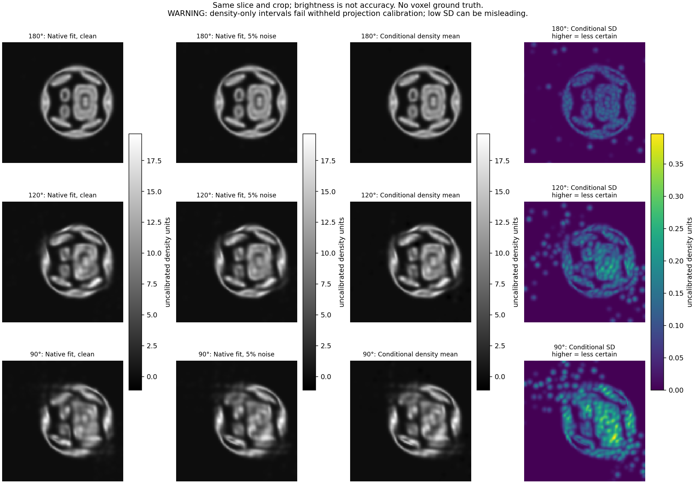

**Read this plot:** the first three columns share density scales and the same
central slice/crop. Brightness indicates density, not correctness. The SD column
has its own scale; larger values mean less certainty under the conditional model.
Low SD is misleading when systematic error is omitted. There is no worm voxel
ground truth against which to validate these density maps.

| Coverage, 5% noise | Native withheld error | Posterior-mean withheld error | Latent 95% coverage | Predictive 95% coverage | Predictive interval width |
|---|---:|---:|---:|---:|---:|
| 120° | 13.36% | 13.23% | 7.90% | 30.66% | 0.2028 |
| 90° | 17.79% | 17.61% | 8.92% | 24.17% | 0.2132 |

Coverage is evaluated on withheld foreground rays where the clean normalized
projection exceeds 0.05, a fixed evaluation-only threshold. Latent intervals are
checked against clean projections; predictive intervals are checked against the
noisy withheld measurements. Width is in normalized projection units. The target
is approximately 95% coverage with useful widths, not maximum coverage or minimum
width alone. This is empirical coverage on one correlated slab, not a repeated
independent-subject calibration study.

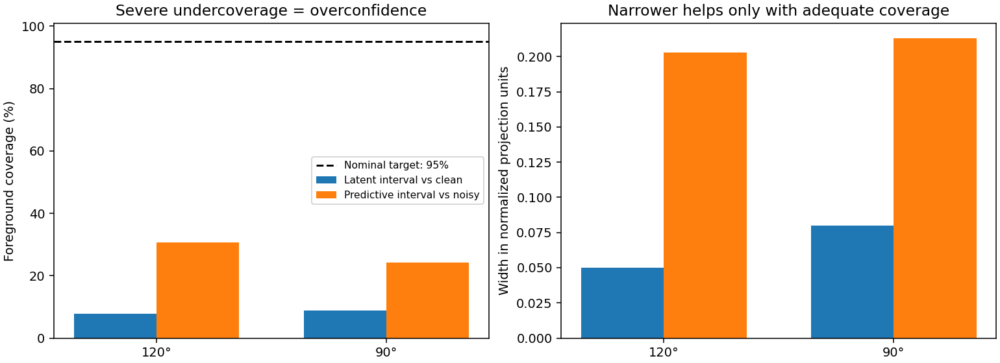

**Finding:** the posterior mean slightly improves withheld error, but nominal 95%
predictive coverage is only 30.66% at 120° and 24.17% at 90°. Latent coverage is
7.90% and 8.92%. The intervals are severely overconfident. Even full-angle measured
foreground latent coverage is only 13.78%, indicating unresolved model error
already before missing-wedge extrapolation. We do not tune intervals on these
withheld results or claim successful uncertainty calibration.

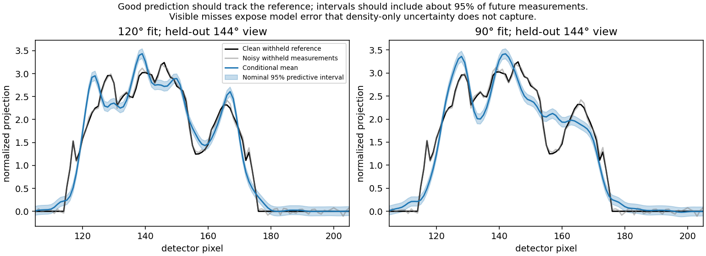

The fixed 144° view, source z=256, is withheld from both limited-angle fits.
A useful mean should follow the clean reference, and predictive bands should
capture future noisy measurements at their nominal rate. Visible misses show
errors not represented by the density-only posterior. Their causes may include
representation capacity, incomplete optimization, plug-in geometry, prior choice
and unresolved simulator conventions; this experiment does not isolate them.

Results and figure provenance:
[record](docs/figures/worm_uncertainty/conditional_density_v1/results.json).
Local outputs: `output/worm_uncertainty/limited_gaussian_v1/` and
`output/worm_uncertainty/conditional_density_v1/`. Twenty-one current tests pass,
including measured-only initialization, rotated analytic ray quadrature,
posterior algebra and latent-versus-predictive interval checks.

Reproduce after the environment activation above, using fresh destinations:

```bash
python -B experiments/worm_uncertainty/limited_gaussian.py \
  --source ../worm_data/worm_004_gt.tiff \
  --output output/worm_uncertainty/limited_gaussian_repeat --execute
python -B experiments/worm_uncertainty/conditional_density.py \
  --input output/worm_uncertainty/limited_gaussian_repeat \
  --output output/worm_uncertainty/conditional_density_repeat --execute
python -B experiments/worm_uncertainty/plot_conditional_density.py \
  --baseline output/worm_uncertainty/limited_gaussian_repeat \
  --posterior output/worm_uncertainty/conditional_density_repeat \
  --output output/worm_uncertainty/conditional_figures_repeat
```

**Next:** use known 3D targets to separate representation/optimization error from
conditional uncertainty, then test geometry uncertainty or an explicit model-error
term on separate calibration cases. Keep these failed-calibration results as a
baseline. Fix protocol choices before evaluation on new deformations or angles.

### Known 3D phantom: separating three sources of error

A controlled CPU experiment now separates fixed-basis representation error,
optimization stopping, and omitted **Gaussian-centre uncertainty**. Here geometry
means the reconstructed Gaussian positions, **not uncertain scanner angles or
alignment**. Acquisition geometry is exact in this experiment.

The frozen `phantom_3d_protocol_v1.json` specifies three anisotropic 3D Gaussians,
36 parallel-beam views at 5° spacing, a 12×24 detector, and a 24³ evaluation grid.
Full/120°/90° acquisitions use 36/24/18 views. Thirty paired Gaussian-noise draws
have SD 5% of the full clean projection RMS; priors and initialization are fixed
before evaluation. These are synthetic density units, not calibrated worm units.
Foreground means truth above 5% of its peak, used only for evaluation.

**Representation control.** Add a fourth component to the truth, then solve
all-view clean least squares exactly with the original three fixed basis
functions. Projection relative error remains **11.283%**, with foreground voxel
RMSE **0.03369**. Restoring the fourth basis function reduces both to numerical
precision. This demonstrates an omitted-component error that further density
optimization cannot fix. It does not measure the best possible fit of three
freely moving/resizing Gaussians.

**Optimization control.** On the matched three-component target, identical starts
and priors are fitted with budgets of 5 versus 150 function evaluations. All long
fits stop successfully after 7 evaluations. Foreground voxel RMSE changes:

| Angular span | Budget 5 (stopped early) | Budget 150 (converged) |
|---|---:|---:|
| 180° | 1.003e-6 | 1.342e-7 |
| 120° | 5.789e-7 | 2.182e-7 |
| 90° | 6.422e-7 | 3.946e-7 |

Lower RMSE is better. Both budgets already yield tiny errors here; this is an easy
matched-model problem. Successful convergence and tiny residuals on this phantom
do not establish convergence of the 1,500-Gaussian worm fit. Remaining clean error
also includes the fixed prior's influence.

**Uncertainty control.** With noisy matched targets, compare an exact density
posterior at true centres, a conditional density posterior at fitted centres,
and a local joint centre+density covariance. The latter two use exactly the same
reconstruction mean; only uncertainty propagation changes. The joint calculation
retains cross-covariances and uses a Gauss–Newton/Laplace approximation and linear
voxel propagation, with fixed widths, rotations and component count.

| Span | Known-centre coverage | Fitted-centre density-only coverage | Joint coverage | Density-only / joint width |
|---|---:|---:|---:|---:|
| 180° | 96.91% | 44.85% | 95.25% | 0.000635 / 0.001780 |
| 120° | 93.96% | 43.41% | 95.05% | 0.000784 / 0.002325 |
| 90° | 96.68% | 40.98% | 96.63% | 0.000921 / 0.003115 |

Coverage is the mean across 30 draws of the foreground fraction inside nominal
95% **latent voxel-density** intervals. Width is mean interval width in synthetic
density units. These differ from the worm experiment's withheld-ray predictive
intervals. Fitted-centre mean voxel RMSE is 0.000502/0.000674/0.000847. All 90 noisy
fits converge without active bounds; conditional density re-solving changes MAP
densities by at most 2.13e-13.

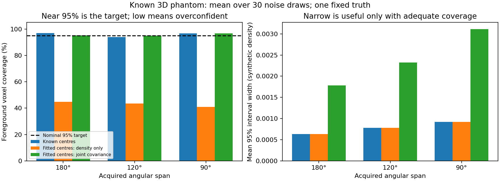

The target is coverage near 95% with useful width. Density-only intervals are too
narrow after centre fitting; carrying centre uncertainty substantially repairs
coverage in this controlled setting. Coverage varies across individual draws and
voxels are correlated, so this table is not 30×foreground independent trials.

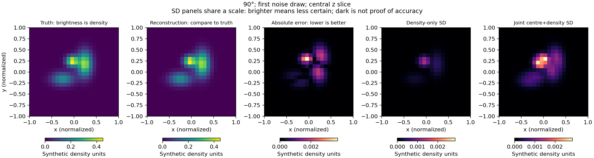

The figure fixes the first noise draw, 90° acquisition and central z slice. Truth
and reconstruction share density limits; both SD panels share limits. Error low
is good; SD low alone is not. Results and provenance are in the
[record](docs/figures/worm_uncertainty/known_3d_diagnosis_v1/results.json).

**Decision for the next uncertainty model:** test a joint centre-and-density local
posterior next, then add widths/rotations under controlled perturbations. Keep the
failed worm density-only baseline. Before transfer, evaluate on separately fixed
phantoms, starts and angular offsets, with withheld-ray coverage as well as voxel
coverage and widths. Include deliberate missing components to test when a
model-error term or richer representation is needed. Scanner-angle/alignment
uncertainty remains a separate, untested question. This matched analytic
synthesis/inference study is a diagnostic, not independent forward-model
validation, proof of worm calibration, or evidence of generalization across
independent volumes. No interval tuning used these reported outcomes.

### Separate phantoms, angular offsets and missing structure

The next frozen CPU stress test uses two new manually specified 3D phantoms
(`separated` and `overlapping`), each with three anisotropic Gaussian components.
The acquisition windows are span/start = 180°/0°, 120°/0°, 120°/60°, 90°/0° and
90°/120°. The last wraps across 180°, selecting [120°,180°) and [0°,30°).
Each condition has ten paired noise draws and two initializations: **400 fits**
across 20 cases. These new synthetic targets are development stress tests, not
independent biological subjects or a blinded validation set.

The protocol, `phantom_stress_protocol_v1.json`, was fixed before execution.
Noise is 5% of each phantom/condition's full clean projection RMS. All angular
windows share the same noise realization within a draw. The priors, 150-evaluation
budget, density bounds, initialization perturbation and fixed widths are inherited
from the earlier control. Initialization centres are perturbed from truth and
widths/component identities are known: this remains an intentionally favourable
inverse problem. Acquisition geometry is exact.

For the mismatch condition, a fourth component is added to the truth while the
fitted model retains three movable components with fixed widths. The density-only
and joint centre+density approximations share the same fitted mean. Both use only
acquired measurements; withheld data and truth-based foreground masks are used
for evaluation. The foreground threshold is 5% of the respective truth peak.

| Condition | Density-only voxel coverage | Joint voxel coverage | Joint withheld latent coverage | Joint withheld predictive coverage |
|---|---:|---:|---:|---:|
| Matched models | 30.46–45.36% | 89.72–96.72% | 89.16–96.82% | 94.95–95.43% |
| Missing component | 1.99–11.40% | 8.86–29.29% | 9.05–22.58% | 43.87–65.32% |

Ranges are across case means, not confidence intervals. Each mean averages ten
noise draws and two starts; starts share those draws and are not independent
noise replicates. Coverage targets 95%. Latent intervals are checked against
clean voxel densities or clean withheld projections. Predictive intervals add
known measurement-noise variance and are checked against noisy withheld rays.
Full-angle cases have no withheld views.

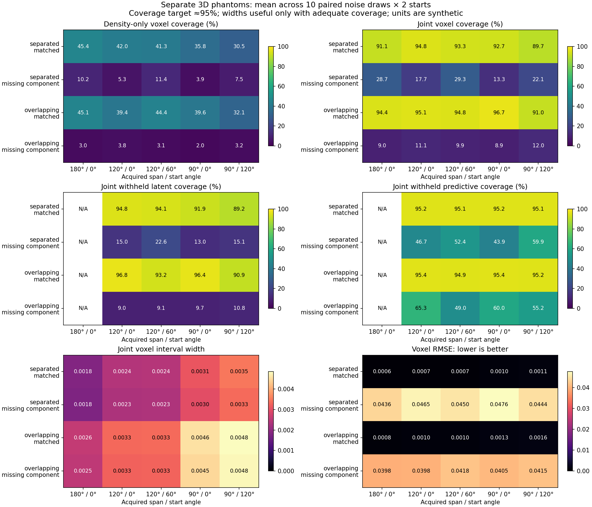

Coverage should be near 95%, not merely high. Narrow intervals are useful only
when they cover the target reliably. Voxel RMSE should be low. Widths and errors
use synthetic density units, not calibrated worm units. Joint voxel interval
widths remain similar under missing-component error, while RMSE rises from
0.00056–0.00156 (matched) to 0.03977–0.04758 (mismatch): the covariance does not
capture the missing structure.

Angular orientation also matters. For the matched separated phantom at 90°,
changing the start from 0° to 120° raises voxel RMSE from 0.00100 to 0.00115 and
lowers joint voxel coverage from 92.73% to 89.72%, although predictive coverage
stays near 95%. Added measurement noise can therefore make predictive coverage
look satisfactory while latent density intervals still under-cover.

All 400 solver runs report successful termination within 15 function evaluations,
with no active parameter bounds. This reduces concern about a simple iteration
budget cutoff in these cases; it does not prove global optimization or remove
model error. Per-draw convergence, optimality, errors and interval metrics are
retained in `output/worm_uncertainty/phantom_stress_v1/draws.json`; the
[tracked result record](docs/figures/worm_uncertainty/phantom_stress_v1/results.json) contains all case
summaries, the frozen protocol, source hashes and the draw-file checksum.

**Decision:** joint centre+density uncertainty remains a useful baseline for
matched representations. It is insufficient for missing structure. Before worm
transfer, test a representation-repair control that restores the fourth component,
then test uncertain widths/rotations and an explicit residual model if systematic
error remains. A residual model must not silently absorb incorrect density or
scanner conventions. Fix those comparisons before evaluation; do not inflate
intervals to fit these reported outcomes. Ten draws and two selected phantoms
leave uncertainty about calibration across shapes and angular configurations.
These results provide no independent-volume or cone-beam generalization claim.

### Component restoration and uncertain Gaussian shape

A paired representation-repair control now restores the previously omitted fourth
component. It uses exactly the previous four-component truth, acquisition windows,
noise draws, prior settings and first-three-component initialization perturbations.
The new fourth component starts near its true centre with its true width: this is
an oracle capacity control, not an automatic component-discovery method. Both
phantoms, five windows, ten noise draws and two starts give **200 repair fits**.

| Four-component target | Joint voxel coverage | Voxel RMSE | Withheld predictive coverage |
|---|---:|---:|---:|
| Three-component fit (previous) | 8.86–29.29% | 0.03977–0.04758 | 43.87–65.32% |
| Restored four-component fit | 90.26–96.32% | 0.000656–0.001748 | 94.84–95.44% |

Ranges summarize case means, not confidence intervals. Nominal coverage is 95%;
RMSE and interval widths are in synthetic density units. All repair fits terminate
successfully within ten evaluations, without active bounds. This paired control
supports missing representational structure as a cause of the earlier failure.
It does not establish that arbitrary worm residuals have the same cause.

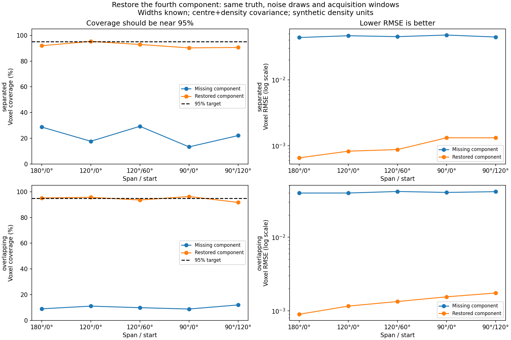

The second stage rotates each of the four true components and learns centres,
log widths, XYZ Euler rotations and densities jointly. Width bounds are 0.04–0.35;
Euler-angle bounds are ±1.4 radians. Gaussian priors have SD 0.35 on log widths and
0.5 radians on rotations, centred on the fixed initialization. Initial widths and
rotations are perturbed from truth (SD 0.1 and 0.15 respectively), so this is still
favourable initialization. The two phantoms use 180°/0°, 90°/0° and 90°/120° windows,
ten noise draws and two starts, giving **120 shape fits**. This stage has rotated
truth and should not be treated as a same-data comparison to the repair stage.

At each fitted mean, nested local Gaussian covariances include density alone,
then centres, then log widths, then rotations. Each covariance is the inverse of
the corresponding principal block of the joint Gauss–Newton precision: excluded
parameters are held fixed, not marginalized. The complete model retains all
cross-covariances. First-order propagation gives voxel and ray uncertainty.

| Parameters included in covariance | Voxel coverage across six cases |
|---|---:|
| Density only | 14.16–25.05% |
| Density + centres | 46.38–66.37% |
| Density + centres + log widths | 66.54–85.03% |
| All, including rotations | 85.47–96.58% |

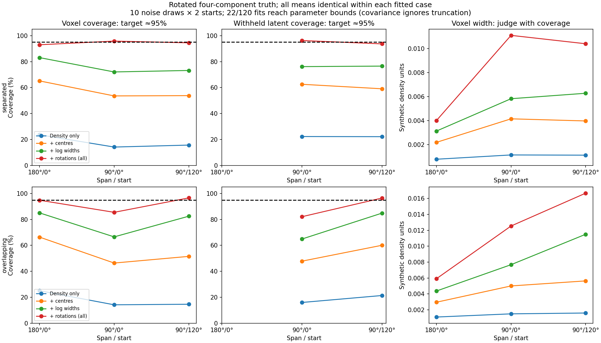

Means are identical across the four covariance choices in each fit. Improvement
therefore comes from propagating omitted uncertainty, not improving the mean.
For example, the separated phantom at 90°/120° has voxel coverage
15.67% → 53.79% → 73.18% → 94.48%; mean interval width grows from 0.00112 to 0.01041.
Coverage must be assessed with width; wider alone is not a success criterion.

**A boundary failure remains.** All 120 shape fits report solver success within
42 evaluations, but 22 fits reach Euler rotation bounds: 4/20 for the separated
phantom at 90°/0° and 18/20 for the overlapping phantom at 90°/0°. The local
untruncated covariance ignores these constraints and is not a valid description
of a constrained posterior near the boundary. For the overlapping case, complete
voxel coverage is only **85.47%**, withheld latent coverage **82.09%**, and withheld
predictive coverage **92.64%**. Its two starts yield voxel coverage 91.58% and
79.37%, showing sensitivity to initialization (and the initialization-centred
prior). A successful stopping condition does not settle this issue.

No bounds or priors were changed after inspecting these results. The
[bound inspection](docs/figures/worm_uncertainty/shape_controls_v1/bound_diagnostics.json) identifies
which component/axis hits a limit. The [result record](docs/figures/worm_uncertainty/shape_controls_v1/results.json)
contains the frozen protocol, all case summaries and provenance. Local
`output/worm_uncertainty/shape_controls_v1/` retains per-fit parameters, convergence
and metrics, plus first-draw truth/reconstruction volumes.

**Next decision before worm transfer:** retain full shape covariance as the
controlled baseline, but test the difficult rotated case with an appropriate
rotation/covariance parameterization or boundary-aware posterior calculation.
Separate changes to parameterization, prior and initialization so any improvement
has an identifiable cause. Test nonlinear posterior propagation against the local
approximation and use new fixed validation cases. Automatic representation
selection and a possible residual model remain open; these toy controls do not
justify transferring a calibrated-uncertainty claim to worms.

### Rotation bounds, initialization sensitivity and a stability check

The follow-up separates two confounded choices in the previous shape fit: Euler
rotation bounds and a prior centred on each optimizer start. A fixed factorial
protocol tests bounded/unbounded rotations with start-specific/shared priors on
90°/0° and 90°/120° overlapping targets plus a new phantom at 90°/60°. Ten noise
draws and two starts give **240 fits**. The shared prior reference uses a separate
fixed seed, 907; it remains perturbed from synthetic truth. The bounded,
start-prior control reproduces the preceding experiment.

Removing rotation bounds improves the original difficult case's voxel coverage
from 85.47% to 91.12%, but creates failures elsewhere: two unbounded fits exhaust
the 150-evaluation budget. Sharing the prior makes objectives comparable across
starts, but does not eliminate local minima. These outcomes argue against simply
removing angle bounds and proceeding with a single fit.

An adaptive **60-fit Cholesky follow-up** represents each covariance as
`Sigma = L L^T`, with positive diagonals represented in log space. This removes
Euler coordinate limits and duplicate rotation representations. It also changes
the shape prior to Gaussian log-diagonal SD 0.35 and raw off-diagonal SD 0.1,
removes width bounds, and uses Jacobian-based optimizer scaling. Consequently,
improvement cannot be attributed to parameterization alone. All these choices
were fixed before that follow-up, without tuning on coverage.

Cholesky coordinates solve the original 90°/0° case stably, but two starts are
insufficient elsewhere. Some fits terminate at poor local minima, and two exhaust
the budget. The plot retains these failures rather than displaying only the
successful first case.

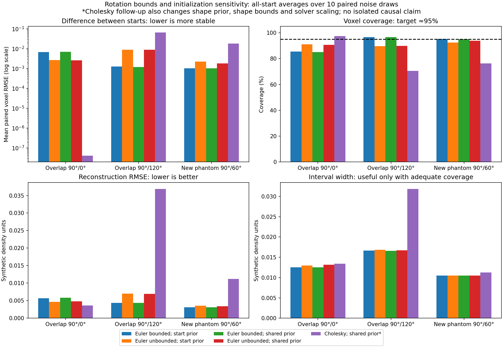

The final optimizer control keeps that Cholesky model and shared prior fixed,
uses starts 81, 193, 907 and 421, and raises the budget to 300 evaluations:
**120 fits**. For each noise draw, the audit selects the two lowest-objective
converged fits. Selection uses acquired measurements plus the fixed prior only.
The stability check requires:

- At least two converged candidates, both without active bounds.
- Relative objective difference at most `1e-5`.
- Relative acquired-prediction difference at most `1e-4`.

The thresholds were fixed before this optimizer follow-up. Truth, withheld rays
and their metrics do not participate in selection or in the check. The audit
returns exit code 2 if any draw fails, so downstream work can be conditional on
success. Passing checks do not establish global optimality or ensure that
unmeasured regions agree.

**All 30 draws pass.** Two of the 120 individual fits still exhaust the budget;
poor converged candidates also remain. The result supports an audited multistart
procedure, not a claim that initialization sensitivity has disappeared from
individual fits. Metrics below use the lowest-objective converged fit per draw.

| Case (span/start) | Stability checks | Voxel coverage | Withheld latent coverage | Predictive coverage | Voxel interval width | Voxel RMSE |
|---|---:|---:|---:|---:|---:|---:|
| Overlap 90°/0° | 10/10 | 97.36% | 96.80% | 95.71% | 0.01341 | 0.003590 |
| Overlap 90°/120° | 10/10 | 97.32% | 96.92% | 95.67% | 0.01711 | 0.004252 |
| New phantom 90°/60° | 10/10 | 95.92% | 96.56% | 94.95% | 0.01049 | 0.003078 |

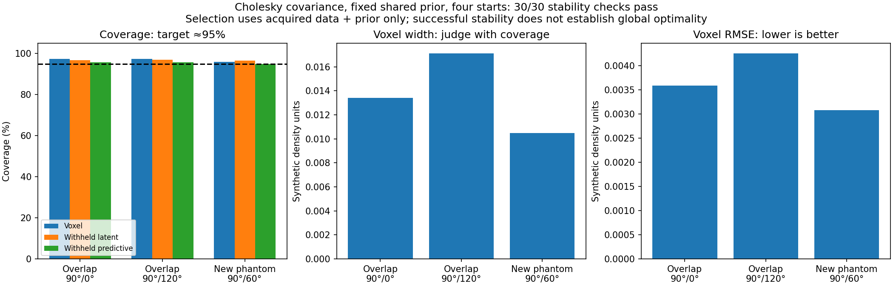

Coverage targets 95%; widths and voxel errors use synthetic density units. These
are means over ten paired noise draws per case, not confidence intervals. The new
phantom was fixed before the factorial test, then reused during the adaptive
Cholesky and optimizer follow-ups. It is therefore development evidence, not an
untouched final validation set. The local Gaussian posterior and linear
propagation remain approximations. Scanner geometry is exact, component count is
known, and starts/prior reference are informed by truth.

**Decision before worm transfer:** the concrete rotation-bound failure is avoided
with positive-definite covariance coordinates; optimizer sensitivity is handled
by a shared prior, multiple starts, measured-objective selection and an explicit
agreement check. Retain this procedure as a candidate and keep the failed controls.
Do not silently accept a single fit or choose a start using withheld performance.
A worm implementation still needs a measured-data-only initializer/prior, a
scalable covariance calculation, and fresh validation of interval calibration;
the toy-model results do not establish calibrated worm uncertainty.

Records: [factorial and two-start follow-up](docs/figures/worm_uncertainty/rotation_sensitivity_v1/results.json),
[audited four-start results](docs/figures/worm_uncertainty/cholesky_multistart_v1/results.json).
The frozen protocols are `rotation_sensitivity_protocol_v1.json`,
`cholesky_protocol_v1.json` and `multistart_protocol_v1.json`. Local outputs retain
all candidates, including failures, with objective values, parameters, convergence
and coverage metrics. Both start/budget changes in the final follow-up are explicit;
it does not isolate their individual contribution.

### 19 October — initialization and priors from acquired data

The next prerequisite removes truth-derived starting positions, widths and prior
references. A fixed dictionary contains 405 isotropic Gaussians (9×9×5 centres,
width 0.14 in normalized coordinates). Greedy residual correlation selects four
atoms, with a nonnegative density solve after each selection. Only acquired noisy
projections and their angles enter this calculation. The resulting parameters
form one shared prior reference for all starts on that acquisition/noise draw.
Prior widths, the component count and the search grid remain fixed design choices.

Two new four-component phantoms (`fresh_spread`, `fresh_cluster`) are tested at
120°/30° and 90°/75°, with ten paired noise draws and four optimizer starts:
**160 initial fits**. Noise SD is a fixed **0.003** in synthetic projection units;
it is not derived from full-angle clean data or withheld measurements. The fresh
protocol was fixed before running these cases. Truth is used for synthesis and
scoring, while withheld views are used only for scoring.

The initial run passes **37/40** stability checks, despite all 160 fits reporting
successful termination without active bounds. The three failures are on the
clustered phantom: their relative objective gaps exceed `1e-5`, while acquired
prediction disagreement remains below `1e-4`. This again shows why solver success
alone is insufficient. The [initial record](docs/figures/worm_uncertainty/measured_init_v1/results.json)
retains these failures and all initial case metrics.

An explicitly adaptive fallback adds seeds 907, 202, 1123 and 151 only to failed
checks. It preserves the measured-data prior reference, 300-evaluation budget and
both agreement thresholds. The extra seed list was fixed before the fallback;
no truth or withheld metric selects which fits to run or accept. **Twelve extra
fits** bring the result to **40/40 passing checks**, with 172 total fits and no
active bounds. The largest final relative objective gap is 1.64e-11 and largest
acquired-prediction disagreement is 3.13e-7. All candidates remain available.

| Fresh case (span/start) | Initial / final checks | Voxel coverage | Withheld latent coverage | Predictive coverage | Voxel width | Voxel RMSE |
|---|---:|---:|---:|---:|---:|---:|
| Spread 120°/30° | 10/10 → 10/10 | 95.45% | 95.85% | 95.30% | 0.00771 | 0.002210 |
| Spread 90°/75° | 10/10 → 10/10 | 95.80% | 95.04% | 94.81% | 0.01127 | 0.003434 |
| Cluster 120°/30° | 9/10 → 10/10 | 95.49% | 94.94% | 95.06% | 0.00901 | 0.002766 |
| Cluster 90°/75° | 8/10 → 10/10 | 96.22% | 96.27% | 94.78% | 0.01523 | 0.004670 |

Metrics average the selected lowest-objective converged fit over ten noise draws.
Coverage targets 95%; widths and voxel errors are in synthetic density units.
Width must be judged alongside coverage, and lower RMSE is better. Fallback
barely changes these aggregate metrics: it supplies corroborating converged fits
rather than tuning intervals against evaluation results.

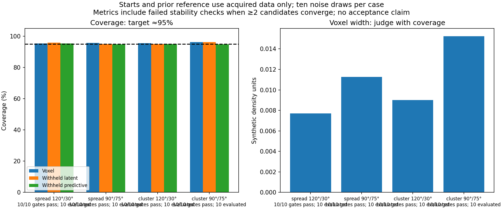

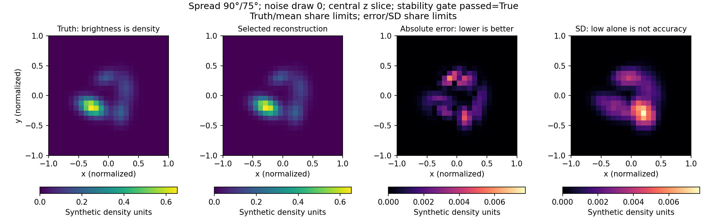

The slice fixes the spread phantom at 90°/75°, noise draw 0 and the central z
plane. Truth/reconstruction share density limits; error/SD share limits. Low error
is good; low SD alone is not proof of accuracy. Coverage elsewhere uses intervals
of approximately mean ±1.96 SD, not ±1 SD.

**Interpretation and remaining limits.** This supports acquired-data initialization
and adaptive multistart selection on fresh matched synthetic targets. The prior
reference is estimated from the same measurements, and local covariance conditions
on that estimate; it is not a full hierarchical posterior that propagates prior
estimation uncertainty. The four-component count is predeclared, the forward
model matches synthesis, and noise is known. The fallback was developed after
seeing the initial failures, so its final results are adaptive development evidence.
Two fresh phantoms do not establish general calibration, biological independence,
or performance under unknown noise and model mismatch.

The next step is a small worm-slab diagnostic using measured-only initialization,
explicit computational limits, and withheld-view error/coverage checks. Its richer
representation and scalable covariance calculation still need implementation and
validation. Retain synthetic checks and failed-run evidence; physical worm density
scaling and matching voxel ground truth remain unresolved.

[Final results and provenance](docs/figures/worm_uncertainty/measured_init_fallback_v1/results.json).
Protocols: `measured_init_protocol_v1.json` and `measured_fallback_protocol_v1.json`.
All 36 CPU tests pass, including exact recovery of a dictionary atom, deterministic
starts and withheld-data isolation. Formatting/static checks pass for 45 scripts.

### 19 October — first measured-only worm shape pilot: stability failure

The measured-only pipeline has now been exercised on actual worm projections,
using a deliberately small CPU diagnostic. It fits 16 Gaussians (160 parameters)
to 17 acquired angles in a 120°/0° window, holding out eight other angles. The
25-angle grid takes every fourth source view; 62 detector samples take every
fifth pixel. Eight axial planes span source z=224…280 in steps of eight. Sampling
is by selecting original rays, not averaging detector bins. This differs from
the earlier contiguous eight-slice, 1,500-Gaussian experiment and is not a direct
performance comparison.

The normalization is the acquired sampled projection RMS, **6094.0105 stored
units**. Synthetic Gaussian noise SD 0.05 is added after normalization, with seed
20261019. Starts and the shared prior reference come only from noisy acquired
samples; withheld projections are reserved for evaluation. The dictionary uses
fixed widths (0.16, 0.16, 0.12), with 11×11×3 candidate centres. Four starts have a
fixed budget of 150 function evaluations each.

**The experiment fails the optimizer stability check.** All four fits exhaust
that budget and retain density parameters at their lower bound. With no converged
candidate, the displayed fit is the lowest-objective unfinished candidate, seed
421. Its maps and covariance are provisional diagnostics; they are not a valid
calibrated posterior or an accepted reconstruction.

| Diagnostic | Result |
|---|---:|
| Converged fits | 0/4 |
| Acquired clean-projection relative error | 20.51% |
| Withheld clean-projection relative error | 25.22% |
| Density-only latent / predictive coverage | 1.52% / 15.91% |
| Full-shape latent / predictive coverage | 5.93% / 16.79% |
| Full-shape predictive mean interval width | 0.20486 normalized projection units |

Coverage targets 95% on withheld foreground rays (clean normalized projection
above 0.05). These very low values are failure diagnostics at an unfinished fit,
not evidence that the full-shape posterior is calibrated. Clean withheld
projections test latent intervals; noisy withheld projections test predictive
intervals. The latter add the known injected noise variance.

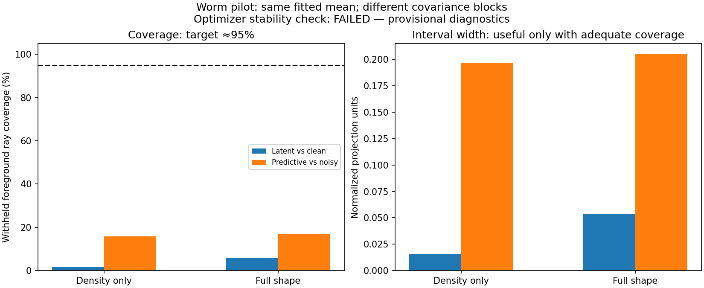

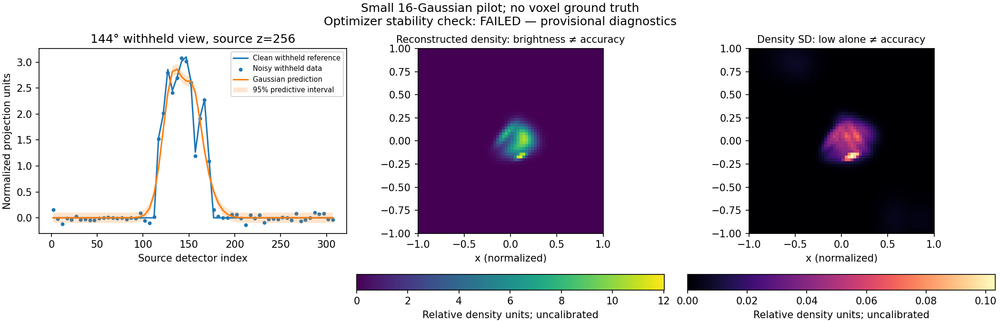

The 144° ray profile at source z=256 is fixed and withheld. Density-map brightness
shows relative reconstructed values, not accuracy; SD is also in uncalibrated
relative density units. There is no matching voxel truth for this worm. Confidence
in fine internal structure or quantitative biological density is not established.

A concrete initialization issue is visible: the nonnegative dictionary solve
assigns appreciable density to only **5 of 16** components; the other 11 are
raised to the initializer floor of 0.01. This motivates a more suitable measured-
data support/grid and width dictionary. It does not isolate the cause of final
error: incomplete optimization, boundary effects, insufficient or poorly allocated
representation, and simulation conventions remain possible contributors.
The local precision condition number is approximately 5.91e9, adding a numerical
conditioning concern to the already failed convergence check.

The 160×160 covariance occupies 204,800 bytes; query uncertainty is evaluated in
chunks. This demonstrates a small dense calculation, not scalability to the
previous 1,500-Gaussian model. The fitting/evaluation portion took about 66 seconds
on this workstation, excluding source hashing and initialization; runtime is not
a controlled benchmark.

**Assessment:** the synthetic work has produced a working implementation and
useful failure checks, but calibrated worm reconstruction has not succeeded.
Next, compare acquired-data initializers with finer, multiple-width dictionaries
or measured-only reconstruction support, then separate solver-budget effects from
component-capacity effects under a fixed evaluation protocol. Keep withheld
metrics for evaluation rather than using them to select starts or inflate
intervals. The failed small pilot is preserved as a reference.

[Results and provenance](docs/figures/worm_uncertainty/worm_shape_pilot_v1/results.json).
The protocol is `worm_shape_protocol_v1.json`; local outputs are in
`output/worm_uncertainty/worm_shape_pilot_v1/`. Thirty-eight CPU tests pass,
including sampled physical coordinates, acquired-only normalization and
anisotropic dictionary consistency. No full GPU training was launched.

### 21 October — paired worm initialization, budget and capacity controls

The failed 19 October pilot is preserved. The new CPU study reuses its exact
saved normalized projections, injected noise, eight sampled axial planes and
120° acquisition mask, verified by SHA-256. This is a development diagnostic on
one worm, one window and one noise draw; it is not independent validation.

The replacement initializer uses a fixed full-field 21×21×3 centre grid and
three transverse widths (0.04, 0.08, 0.16), retaining axial width 0.12. Greedy
nonnegative fitting sees only acquired noisy rays; minimum centre spacing is
0.04. The 3,969-atom dictionary occupies about 268 MB, with derivative
intermediates computed in chunks of 64 atoms. This is a small CPU reference,
not a demonstrated scalable alternative to the native GPU reconstruction.

The frozen protocol compares new starts with the old prior (16 components,
150 evaluations); new starts with a matching acquired-data prior (16/150);
the same latter starts/prior with a larger budget (16/450); and more components
(32/450). All arms retain four seeds, data, noise variance, solver tolerances
and acceptance thresholds. The component-count comparison also changes the
prior dimension. Grid spacing, width choices and separation change together,
so this does not isolate which dictionary design choice helps.

For the old-prior arm, deterministic nearest-centre assignment matches component
labels. Seed 0 gives a paired unperturbed prior comparison; label reordering
means the other seeds' perturbations differ between old- and new-prior arms.
The 16-component 150-versus-450 budget comparison uses identical initial
parameters and priors for every seed. Start selection uses acquired-data
objectives only. If no candidate converges, the lowest unfinished objective is
retained solely for provisional diagnosis. A passing gate additionally requires
two converged starts, objective/prediction agreement, and no active bounds.

No new uncertainty intervals are computed in this study: optimization must be
resolved before interpreting local covariance as a posterior. Lower clean
projection error is better, but it does not establish voxel accuracy or
calibration. Matching voxel truth and physical projection scaling remain
unresolved.

The new initializer assigns appreciable starting density to **16/16** components
(the old initializer: **5/16**). Its acquired noisy-data relative residual falls
from **37.15% to 23.02%**. With 32 components, **31/32** are appreciably active and
the realized residual is **21.38%**, including the density floor. “Active” here
means starting density strictly above 0.01; it is not a solver bound diagnostic.

Increasing the 16-component budget from 150 to 450 produces two converged starts,
but their relative objective gap is **5.19%** and acquired-prediction disagreement
is **5.48%**. Acceptance thresholds remain **0.001%** and **0.01%**, respectively.
The other two starts are unfinished. Thus neither solver success for one start
nor improvement in projection error establishes a stable reconstruction.

| Setting | Solver budget | Converged starts | Acquired clean error ↓ | Withheld clean error ↓ | Stability |
|---|---:|---:|---:|---:|---|
| Preserved old initializer/prior, 16 Gaussians | 150 | 0/4 | 20.51% | 25.22% | Fail |
| New initializer, old prior, 16 Gaussians | 150 | 0/4 | 11.34% | 20.93% | Fail |
| New initializer/prior, 16 Gaussians | 150 | 0/4 | 11.34% | 23.12% | Fail |
| New initializer/prior, 16 Gaussians | 450 | 2/4 | 11.20% | 19.84% | Fail |
| New initializer/prior, 32 Gaussians | 450 | 0/4 | 8.37% | 23.81% | Fail |

Errors are relative L2 over all rays in the indicated clean evaluation set,
not foreground-only coverage measures. Each row uses its predeclared acquired-
objective selection rule; none is selected by withheld error. All four new
settings fail acceptance, and only 2 of the 16 new starts report solver success.
The four 32-component objectives range from approximately 32,119 to 87,962,
with every start exhausting its 450-evaluation budget.

**Interpretation:** better initialization substantially improves the provisional
fit. More iterations permit some solver termination but leave distinct solutions.
Increasing component count reduces acquired error while worsening withheld error
relative to 16 components at the same budget. This is a warning against equating
training fit with missing-view generalization, not proof of a capacity optimum:
none of these settings passes stability, and the capacity comparison also changes
the prior dimension. Representation error cannot yet be separated cleanly from
incomplete optimization. These sparse-sampling results are not directly comparable
to the earlier 1,500-Gaussian contiguous-slab baseline.

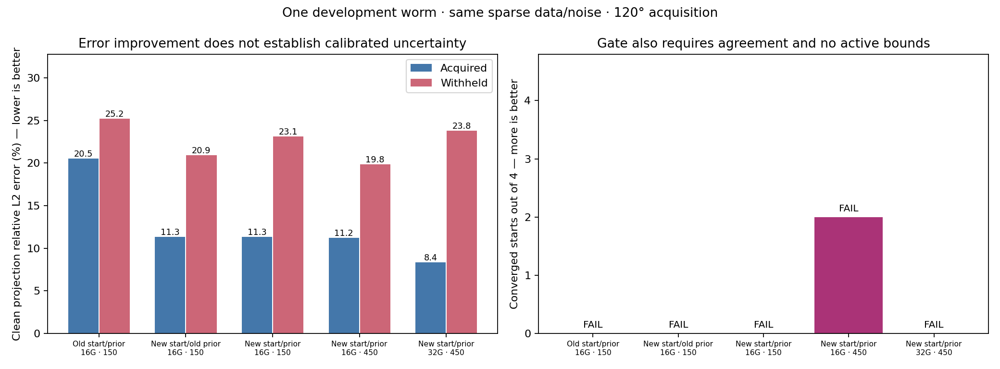

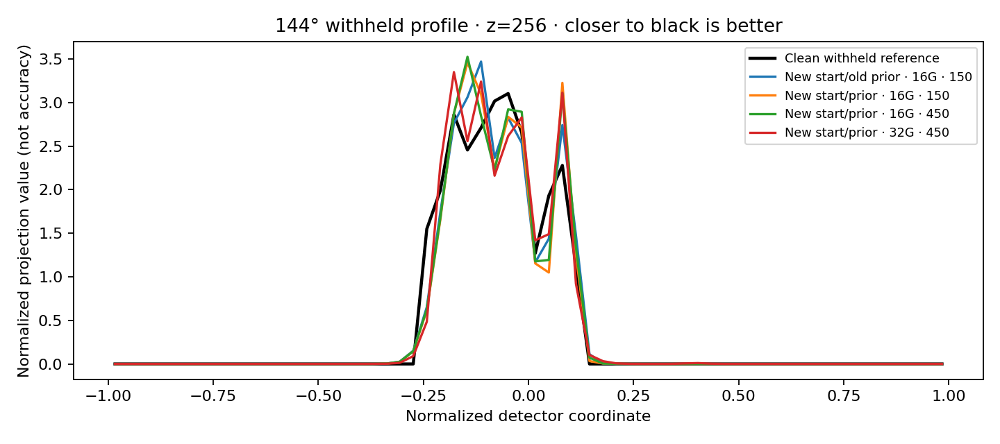

The profile uses the same preselected 144° view and source z=256 as the parent
pilot. Closeness to the black reference is better; projection intensity itself
is not a quality score. No error bars or calibration claims are inferred from
this single noise realization.

**Next:** freeze a staged density → centre → full-shape optimization comparison
under a fixed shared prior, retaining the same data and withheld-only evaluation.
Evaluate both optimization agreement and missing-view error before adding new
posterior intervals. Physical projection scaling, matching deformed voxel truth,
and deformation-separated evaluation remain outstanding. The Weeks 4–5 evidence includes these failed worm checks alongside the
controlled-phantom results; calibrated worm uncertainty remains unresolved.

[Compact results and provenance](docs/figures/worm_uncertainty/worm_fit_controls_v1/results.json).
Protocol: `experiments/worm_uncertainty/worm_fit_controls_protocol_v1.json`;
local full outputs: `output/worm_uncertainty/worm_fit_controls_v1/`.
Checks: **42 CPU tests passed**, all **51 experiment Python files** pass the pinned
formatter/linter, saved parent/artifact hashes are verified, and the default dry
run writes no output. All 16 fits finished; no GPU experiment was launched.

### Weeks 4–5 closing assessment — 21 October 2026

The completed work establishes a tested parallel-beam Gaussian reconstruction
and uncertainty research pipeline. Controlled phantoms show why density-only
uncertainty can miss geometry error, why missing structure defeats local shape
uncertainty, and why solver bounds and initialization must be audited. These
results support further joint density/geometry inference under the tested model
assumptions. **Calibrated uncertainty on the worm data remains unresolved.**

| Evidence at closure | Final finding | Scope and interpretation |
|---|---|---|
| Known-target, acquired-data initialization | 40/40 stability checks pass after 12 extra starts on three failed draws; voxel coverage 95.45–96.22% | Nominal 95% intervals on two fresh matched-model phantoms and two acquisition windows; adaptive fallback and a prior estimated from acquired data limit the claim |
| Earlier worm conditional-density posterior | Predictive coverage 30.66% / 24.17% at 120° / 90° | Far below the nominal 95% target; fixing Gaussian geometry leaves substantial error unexplained |
| Final sparse worm controls, 16 components / 450 evaluations | Acquired / withheld error 11.20% / 19.84%; 2/4 starts converge | Start agreement fails; the reconstruction and uncertainty are not accepted |
| Final sparse worm controls, 32 components / 450 evaluations | Acquired / withheld error 8.37% / 23.81%; 0/4 starts converge | Better acquired fit does not yield better missing-view reconstruction in this comparison |

Coverage should be judged against its nominal 95% target together with interval
width; lower projection error is better. These rows describe different protocols
and sampling schemes and must not be ranked as one benchmark. The latest
16-fit study completed normally, preserved every candidate, and failed all four
stability checks. Failed acceptance is a research result, not an interrupted job.
The final implementation passes **42 CPU tests** and formatting/lint checks for
**51 experiment Python files**. Input, output and source hashes are recorded;
prior chest results and worm pilots remain preserved.

The main unresolved question is how much worm error comes from the representation,
incomplete optimization, or the simulator/operator convention. No matching
voxel truth is available; physical projection scaling is unverified. The data
contain deformations of one synthetic worm, so independent-specimen generalization
and quantitative biological density accuracy have not been demonstrated. The
latest controls use one acquisition window and one noise draw; no transfer claim
follows from them. Geometry-dependent regularization remains a historical
hypothesis, with effectiveness and novelty unverified.

**Next reporting week:** compare staged density → centre → full-shape fitting
under a fixed shared prior before interpreting new posterior intervals. Freeze
that comparison and its acceptance checks before execution. Once optimization is
stable, test withheld angular offsets/spans and reserved deformations, then assess
uncertainty coverage and interval width on known targets. Resolve projection
scaling and request matching deformed density volumes with Anna-Louise. These
are planned tasks, not completed Weeks 4–5 results. The detailed experiment plan
and reproduction commands are in the [worm experiment README](experiments/worm_uncertainty/README.md);
[NEXT_WEEK.md](NEXT_WEEK.md) contains the completed-week summary and next-week plan.

## Week 3 — ordinary-TV controls (3–9 October 2026)

Two development baselines completed 30,000 iterations with 50 views, a 120° span,
TV weight 0.05, seed zero, and the same chest reference and evaluation projections:

| Acquisition start | Volume PSNR | Slice-averaged SSIM | RMSE | Boundary MAE |
|---|---:|---:|---:|---:|
| 0° | 30.913 dB | 0.9010 | 0.02847 | 0.03880 |
| 90° | 28.591 dB | 0.8624 | 0.03719 | 0.05654 |

These reproduce the completed pilot and demonstrate orientation sensitivity on
**one development volume**. They do not establish independent-volume generalization.
Metrics use the supplied unit-range reference without clipping predicted values.
See the protocol for the SSIM and boundary definitions.

As of 8 October 2026, all four ordinary-TV controls (weights 0.025 and 0.1 at
both orientations) have completed. **TV 0.05 remains the frozen reference** under
the predeclared selection rule. A six-subject LIDC-IDRI candidate cohort is recorded;
the first development series has been downloaded and passed its DICOM header audit.
Pixel preprocessing and independence from the pilot remain unverified. Reserved
acquisitions are untouched and no GPU training is queued. See the
[independent-volume preparation](experiments/independent_volume_evaluation/README.md)
for results, evidence and remaining gates.

### Complete TV comparison

| Start | TV | PSNR (dB) | SSIM | Boundary MAE |
|---|---:|---:|---:|---:|
| 0° | 0.025 | 30.766 | 0.8986 | 0.03833 |
| 0° | 0.05 | 30.913 | 0.9010 | 0.03880 |
| 0° | 0.1 | 30.782 | 0.8989 | 0.04060 |
| 90° | 0.025 | 28.538 | 0.8602 | 0.05611 |
| 90° | 0.05 | 28.591 | 0.8624 | 0.05654 |
| 90° | 0.1 | 28.448 | 0.8602 | 0.05823 |

[Week 3 TV tradeoff plot (PDF)](Reports/Week3/figures/tv_tradeoff.pdf)

Lower TV slightly reduces boundary errors but lowers SSIM; higher TV worsens both.
The recorded selection rule retained 0.05. The 2.32 dB orientation gap persists,
with one volume and one seed. No population-transfer claim follows. See the
[complete Week 3 report](Reports/Week3/README.md), including convergence and slice
plots. The LIDC-IDRI expansion was prepared but deferred before reconstruction.

## Week 2 — baseline to limited angle (26 September–2 October 2026)

Reproduced the original 50-view chest cone-beam pipeline, then regenerated noiseless
full-circle and 120° acquisitions with the same projection count, reference and
shared evaluation views. A rotated 120° acquisition exposed orientation sensitivity.
Each acquisition uses its own measurement-derived initializer, so the effect includes
initialization changes. Holding view count fixed changes angular spacing as well
as coverage; this was a feasibility experiment on one reference, not a cohort study.

Established the CUDA 11.8 research environment and addressed TIGRE context-reset
failures. The inherited backprojection patch preserved the saved initializer
exactly; later forward projection checks required isolated processes. Original
runs and their provenance remain available. The subsequent Week 3 benchmark uses
a different disjoint evaluation grid, so its projection scores must not be pooled
with the historical pilot.

See the [Week 2 report](Reports/TRDP2_Week1.pdf) (original filename retained),
[baseline records](experiments/baseline_chest_50views/README.md) and
[pilot protocol](experiments/limited_angle_120/README.md) for the recorded results.
No earlier weekly report is reconstructed from unverified numbers.

## Project guide

Start with the [next-week handoff](NEXT_WEEK.md) for current priorities and
[repository map](docs/REPOSITORY_MAP.md) for active versus historical material.

- [Historical workstation-transfer snapshot](experiments/ordinary_tv_controls/HANDOFF.md)
- [Generalization protocol and split rules](experiments/limited_angle_generalization/protocol.md)
- [Benchmark preparation and verification](experiments/limited_angle_generalization/README.md)
- [Guarded single-case workflow](experiments/limited_angle_generalization/workflow.md)
- [Ordinary-TV controls and selection rule](experiments/ordinary_tv_controls/README.md)
- [Independent-volume data research and intake plan](experiments/ordinary_tv_controls/independent_volumes.md)
- [Saved results and transfer inventory](experiments/ordinary_tv_controls/session_20261007/)
- [Historical limited-angle pilot](experiments/limited_angle_120/README.md)
- [Initial baseline reproduction](experiments/baseline_chest_50views/README.md)
- [Research handoff specification](TRDP2_CODEX_HANDOFF.md)

## Code readability before execution

The active worm Python scripts use consistent formatting and basic static checks.
See [the code style guide](docs/CODE_STYLE.md) for setup, previewing changes and
formatting on save. With the isolated formatting environment installed:

```bash
make format-diff PYTHON=.venv-style/bin/python  # preview formatting
make format PYTHON=.venv-style/bin/python       # apply formatting
make check PYTHON=.venv-style/bin/python        # check before experiments
```

GitHub also checks this style on relevant pushes and pull requests. These CPU-only
checks do not execute experiments; scientific correctness remains covered by the
experiment tests and diagnostics. Historical result hashes retain their original
source provenance after formatting.

## Setup and safe continuation

```bash
git clone --recursive https://github.com/zunaaaaayed/trdp2.git
cd trdp2
```

The verified university stack used Python 3.9.23, PyTorch 2.1.2+cu118, CUDA 11.8,
NumPy 1.24.4, Open3D 0.18, and an RTX 4000 Ada GPU. The local Conda environment is
named `trdp2-r2`. Native extensions and TIGRE must be checked on a new computer;
copied compiled binaries are not assumed portable. Follow the
[current handoff](NEXT_WEEK.md) before GPU execution.
The Python package remains named `r2_gaussian` to preserve the verified baseline.

After activating the research environment:

```bash
python -B -m unittest discover -s experiments/limited_angle_generalization/tests -v
python -B -m unittest discover -s experiments/ordinary_tv_controls -p 'test_*.py' -v
python -B -m unittest discover -s experiments/independent_volume_evaluation -p 'test_*.py' -v
```

Historical guarded GPU runners require an explicit `--execute`; the current CPU
diagnostic scripts run directly. Existing destinations are rejected;
exact checkpoint continuation is not verified. TIGRE forward projection is
isolated from live PyTorch CUDA tensors because its context reset caused a
segmentation fault in the original combined smoke process.

Data, checkpoints, logs, and compiled extensions are excluded from Git. Transfer
the current data and artifacts as well as this repository. The obsolete
7 October transfer archive is eligible for removal only after every member is
verified against the retained files; see the [cleanup record](docs/maintenance/cleanup_20261017.json).
Frozen source/data hashes must remain valid. Historical records
retain their original repository name and workstation paths for provenance.

Original installation options, data-generation instructions, and CLI reference
are preserved in [README_UPSTREAM.md](README_UPSTREAM.md); these are inherited
upstream documentation, not claims about TRDP2 results.

## Attribution and license

TRDP2 research extensions are maintained by Md Zunayedul Islam. The original
R²-Gaussian implementation and its dependencies retain their authorship and
applicable terms. See [LICENSE.md](LICENSE.md) and the license files in each
submodule. Renaming this project does not replace those licenses or transfer
ownership of the original implementation.

The inherited implementation builds on
[Gaussian Splatting](https://github.com/graphdeco-inria/gaussian-splatting),
[SAX-NeRF](https://github.com/caiyuanhao1998/SAX-NeRF),
[NAF](https://github.com/Ruyi-Zha/naf_cbct), and
[TIGRE](https://github.com/CERN/TIGRE).

When using the original reconstruction method, cite its paper:

```bibtex
@inproceedings{r2_gaussian,
  title={R$^2$-Gaussian: Rectifying Radiative Gaussian Splatting for Tomographic Reconstruction},
  author={Ruyi Zha and Tao Jun Lin and Yuanhao Cai and Jiwen Cao and Yanhao Zhang and Hongdong Li},
  booktitle={Advances in Neural Information Processing Systems (NeurIPS)},
  year={2024}
}
```

For TRDP2 experiments, additionally reference this repository and the exact commit
and protocol used. No separate TRDP2 method publication is claimed here.
