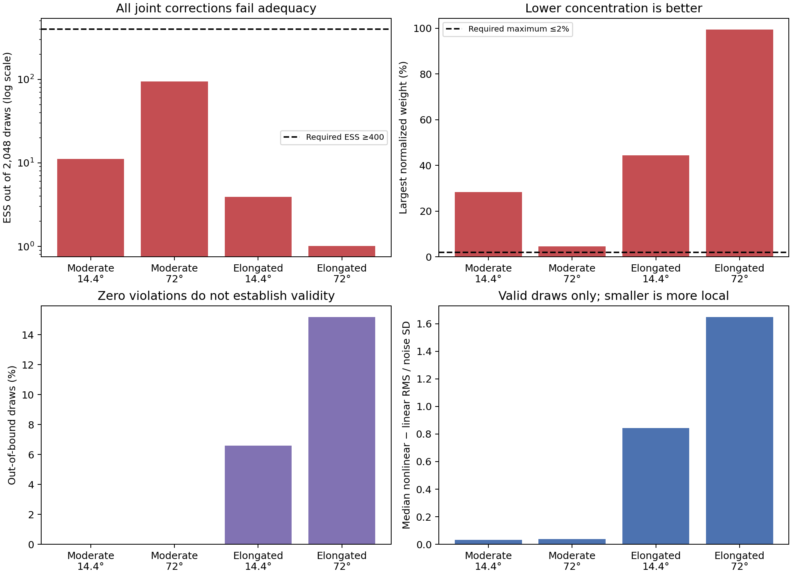
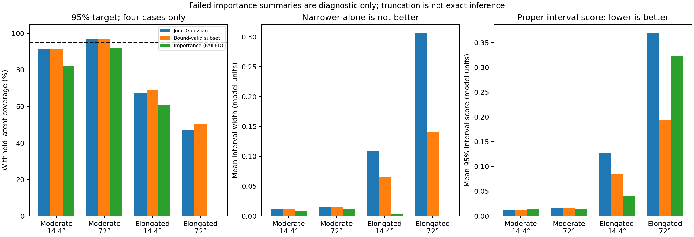

# Nonlinear posterior audit v1 — completed 28 October 2026

## State and scope

Started clean on `experiment/worm-uncertainty`, commit936f8c7, with no newer results
or active research processes. No applicable AGENTS.md was found. The cumulative
README and saved results supersede the old optimization-first continuation text
in NEXT_WEEK.md and the 27 October literature review. Historical outputs, all31
eligible cases, and the excluded `27102_elongated_72.0_20261102` are unchanged.
No optimizer refitting, GPU training, Git push or merge was performed.

Frozen design: `nonlinear_posterior_protocol_v1.json`. Four cases from the existing
eligible cohort: phantom27101, noise20261101, moderate/elongated shapes, start14.4/72
and span120. No selection by truth/error was introduced. This is a deliberately
small diagnostic, not a new calibration cohort or independent-volume study.

## Exact target and measure

For K=5 the 50-vector is `[centres(15), log Cholesky diagonal(15), raw Cholesky
lower off-diagonal(15), amplitudes(5)]`. Within each component the off-diagonal
order is (10,20,21). Shape covariance is L L^T with exp(log-diagonal) on L's
diagonal. Density is an unnormalized Gaussian mixture with peak amplitudes a_k,
not a mixture whose weights sum to one. These are model units.

The target density is with respect to Lebesgue measure in **these original50
coordinates**. Conditional on saved acquired observations y_A, fixed sigma,
known parallel-beam geometry and prior reference m:

    log pi(p | y_A) = -0.5 ||(P_A(p)-y_A)/sigma||²
                     -0.5 ||(p-m)/s||² + log 1_B(p) + constant.

P_A is the implemented continuous analytic Gaussian line integral, not a new
voxel/discrete-pixel simulator. Independent additive Gaussian noise has fixed
sigma=0.05 times the clean acquired projection RMS used in the parent experiment.
This is an oracle simulation noise scale, reused unchanged; it is not re-estimated
from withheld data. Geometry prior mean is **true phantom geometry**. Amplitude
prior mean is0. Standard deviations are centres0.3, log-diagonals0.5,
off-diagonals0.1, amplitudes10. Bounds are centres[-0.95,0.95], amplitudes[0.001,100];
shape coordinates are unbounded. Exp on the Cholesky diagonal does not introduce
a new Jacobian here: the declared prior already lives in log-diagonal coordinates.

The phantom prior is not estimated from the acquired measurements. The inherited
base-configuration prose mentions the earlier worm data-derived reference; that
prose does **not** describe the phantom target. Conditional on truth-based geometry
and oracle sigma, no new truth values enter fitting, weighting or adaptation.
Truth is otherwise evaluation-only. Uncertainties omitted: component count/model
mismatch, acquisition angles/alignment, noise-scale inference, learned or selected
prior-reference uncertainty and unseen modes. Independent-start agreement is not
proof of unimodality.

Parent saved objectives are full squared-residual sums. Numerical evaluation
matches them to rtol1e-12/atol1e-8 after multiplying log target by-2. Gaussian
normalizing constants are parameter-independent and omitted from the target;
normalized proposal constants are retained. Constants cancel in normalized weights.

## Proposal and computation checks

The joint Gauss–Newton covariance is inverse(J^T J/sigma²+diag(s^-2)). With
A=J diag(s)/sigma, chol(A^T A+I)=L, factor F=diag(s)L^-T and covariance F F^T.
We recompute and verify it against saved covariances. Draws p_hat+Fz use the parent
seed2026102701+case-index. The first1024 of2048 draws exactly reproduce the previous
comparison. Density-only uses the five amplitude coordinates and conditions on
all45 fitted geometry values; its log target/proposal are compared in5D, never
against a singular50D proposal density.

Each sample records original parameters, bounds, exact acquired nonlinear log
likelihood, log prior, unnormalized bounded log target, proposal log density,
log weight, nonlinear-versus-linear projection RMS/noise SD and output summaries.
Invalid samples retain their diagnostic likelihood/prior but have target log
probability minus infinity. No clipping. Bound-valid draws also provide a
truncated-Gaussian comparator, explicitly not the nonlinear posterior.

Weights use logsumexp. Predeclared exploratory screens require ESS≥400 and≥20%
of draws, max weight≤2%, disjoint-half mean shifts≤0.2 weighted output SD and
interval-width shifts≤20%. ESS400 corresponds heuristically to ten effective
draws per2.5% tail; scalar ESS is not tail-specific ESS, so passing is necessary,
not sufficient. Half-batch checks cannot detect modes the proposal never visits.
No criterion was changed after seeing outcomes.

## Results: correction fails even without bound violations

| Joint proposal | Valid draws % | ESS/2048 | Max weight % | Median nonlinear discrepancy / sigma, valid draws |
|---|---:|---:|---:|---:|
| Moderate14.4° |100.00|11.10|28.40|0.0317|
| Moderate72° |100.00|94.64|4.57|0.0369|
| Elongated14.4° |93.41|3.93|44.39|0.8422|
| Elongated72° |84.81|1.01|99.42|1.6483|

All four fail. Density-only is the positive calculation control: all valid,
ESS≈2048 and virtually constant weights, as expected from the conditional linear
Gaussian model away from bounds. Its correct conditional computation does not
resolve previously demonstrated joint-uncertainty undercoverage.

Budget sensitivity at512→1024→2048: joint ESS51.82→4.57→11.10 (moderate14.4),
34.49→51.26→94.64 (moderate72),1.46→3.04→3.93 (elongated14.4),
1.01→1.00→1.01 (elongated72). More draws do not automatically make correction
usable. Disjoint1024-draw batch ESS are4.57/18.56,51.26/44.21,3.04/3.13 and1.00/1.01.
The worst batch mean shift exceeds40 weighted SD; both elongated72 intervals
collapse to zero width, so identical zero widths are not stability evidence.

Bound violations are one problem, not the whole explanation. Moderate draws
violate no bounds, yet weights are concentrated. Small per-ray nonlinear changes
can matter when the likelihood sums over19,737 acquired rays. Elongated samples
show much larger nonlinear errors even **within** bounds. Geometry/density
coupling, curvature and nonlinear posterior mass are implicated; this audit does
not identify a unique cause or rule out additional modes. It does not test model
mismatch, and the oracle prior limits transfer.

For elongated14.4/72, nonlinear joint acquired latent coverage is34.64/12.79%;
truncating improves this only to36.30/13.51%. Withheld latent coverage is67.31/47.29%
and truncation gives68.90/50.39%. Rejecting bounds does not fix the nonlinear
approximation. Weighted summaries are saved but **unreliable**: elongated72 gives
zero-width intervals and zero coverage due to weight collapse, not certainty.

The saved per-case tables jointly report density coverage/width/error and acquired/
withheld latent coverage/width/error, with a95% interval score:

    score = (upper-lower) + 40 max(lower-truth,0) + 40 max(truth-upper,0).

Lower scores are better; this is a proper score for the central interval, not a
score identifying the entire distribution. All widths/errors use model units or
relative L2, without physical-density claims. Foreground masks and queries are
unchanged; empirical weighted inverse-CDF quantiles differ slightly from the
previous interpolated unweighted percentile convention. This is documented, not
a rewriting of old results. No future-noisy predictive coverage was computed.
[Interval-score reference, section6.2](https://sites.stat.washington.edu/people/raftery/Research/PDF/Gneiting2007jasa.pdf).

## Bounded reference feasibility: failed mixing, no reference claim

Importance failure triggered a small fixed random-walk Metropolis experiment.
The50D model, inexpensive mean-only projector and existing covariance make this
a useful low-cost feasibility control. It is not assumed efficient for a curved
posterior. Symmetric steps0.33658 Fz operate in original coordinates, reject hard
bounds and use exact log target; the affine Jacobian is constant. No log-amplitude
transform or prior change. There is no adaptation or tuning on these cases.

Each of four chains uses300 warmup+700 recorded states. Starts are the accepted
selected fit, alternative accepted fit, and two valid local perturbations of
size0.25Fz. These starts test local initialization dependence only, not distant
modes. The600-second soft limit is checked between chains; the actual run took
27.58 seconds, far below it. CPU work was bounded by8,000 proposals.

| Case | Acceptance per chain % | Max split Rhat | Min ESS | Decision |
|---|---|---:|---:|---|
| Moderate14.4° |8.4,15.2,12.6,11.0|2.265|5.03|Fail|
| Elongated72° |0,0,0.8,0.4|23.861|4.01|Fail|

Bounds violations:0. Two elongated chains never move. Diagnostics cover all50
whitened coordinates, log target and foreground mean density/acquired/withheld
outputs. Withheld output diagnostics are evaluation-only and never tune the
sampler. Thresholds Rhat≤1.01 and ESS≥400 fail decisively. Recorded chain means,
intervals and errors are **unconverged diagnostic outputs**, not reference estimates.

These are classical split Rhat/positive-sequence ESS feasibility checks, not
rank-normalized/tail diagnostics. A future successful run must additionally use
rank/folded Rhat and bulk/tail ESS, adequate dispersed initialization and independent
replication before claiming a reference. Warmup trajectories and rejected proposal
positions are not retained; repeated retained states and acceptance rates record
rejections in the sampling phase. No claim of exhaustive mode exploration follows.
[Modern diagnostic limitations](https://arxiv.org/abs/1903.08008).

## Decision and next bounded experiment

Do not correct the current joint Gaussian intervals using these weights. Do not
present truncated or short-chain intervals as calibrated uncertainty. Next test
a target-preserving sampler with joint-geometry proposals that can follow curvature,
and exploit the conditional density block where helpful. Use a separate tuning
case; freeze the proposal/gradient checks and settings before the two evaluation
cases. Conditional positivity must remain exact (e.g. constrained conditional
sampling); solving the density MAP each step is **not** Gibbs sampling. A longer
run of the unchanged stuck random walk is not the default next step.

This is an inference decision. It neither demonstrates nor prevents an independent,
small supervised completion/initialization study. See `COMPLETION_PROTOCOL.md`.

## Resources and reproducibility

Host liet, Intel Core Ultra9 285,24 logical CPUs,62GiB RAM, shared mount99GiB
with41GiB used/59GiB available at audit. Python3.9.23, NumPy1.24.4, SciPy1.10.1;
research torch2.1.2+cu118 stack retained. No GPU used. Read-only outside-sandbox
GPU check: RTX4000 Ada,20475MiB total; allocation is shared and availability must
be rechecked before future training. Sandbox nvidia-smi initially failed; that
was not evidence of a broken host driver.

Audit72.43s + feasibility27.58s; complete process100.62s, peak RSS556852KiB
(~544MiB), one CPU thread, exit0. Raw output4.8MiB remains in
`output/worm_uncertainty/nonlinear_posterior_v1`. Compact summary, both plots and
all raw artifact hashes are versioned in `docs/figures/worm_uncertainty/nonlinear_posterior_v1`.
Protocols, source/input hashes, draws, log densities, all case decisions and
reference chains are retained. Old output destinations were never overwritten.

`verify_nonlinear_audit.py` checks integrity, source hashes, objective factors,
saved covariances, original first1024 draws, bounds and documented failed decisions
without refitting or resampling. New unit tests cover general covariance factors,
linear-Gaussian importance weights, stable logweights, scalar truncated sampling,
interval score, split diagnostics, mask/noise reproducibility, withheld isolation,
source grouping and parallel-beam reversal against the analytic projector.
