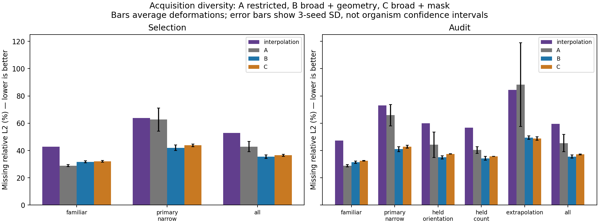
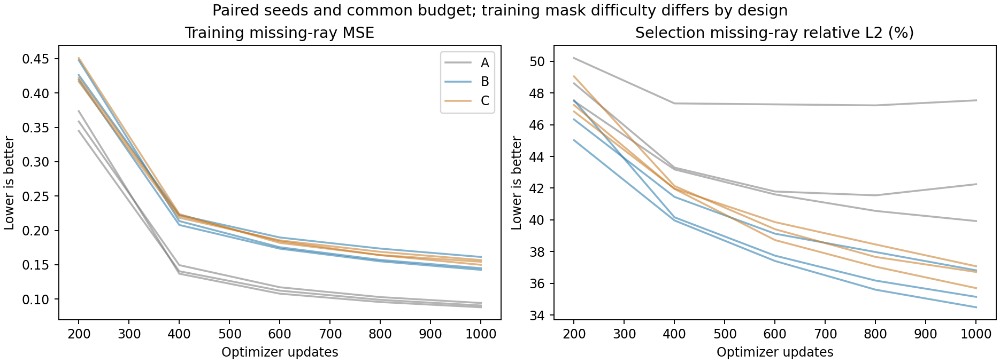
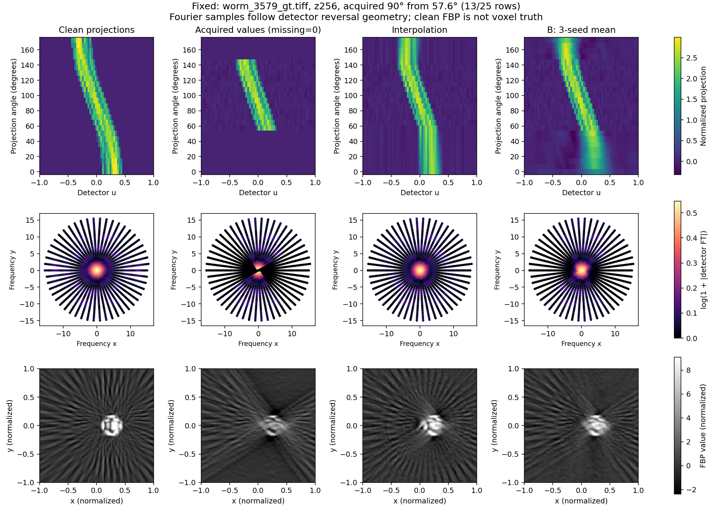
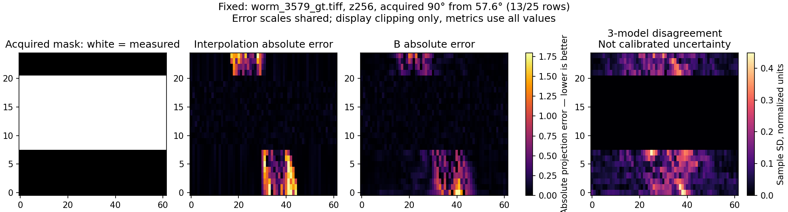
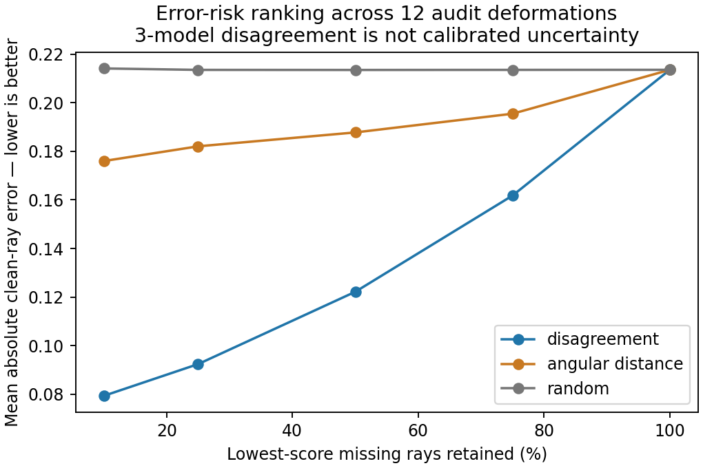
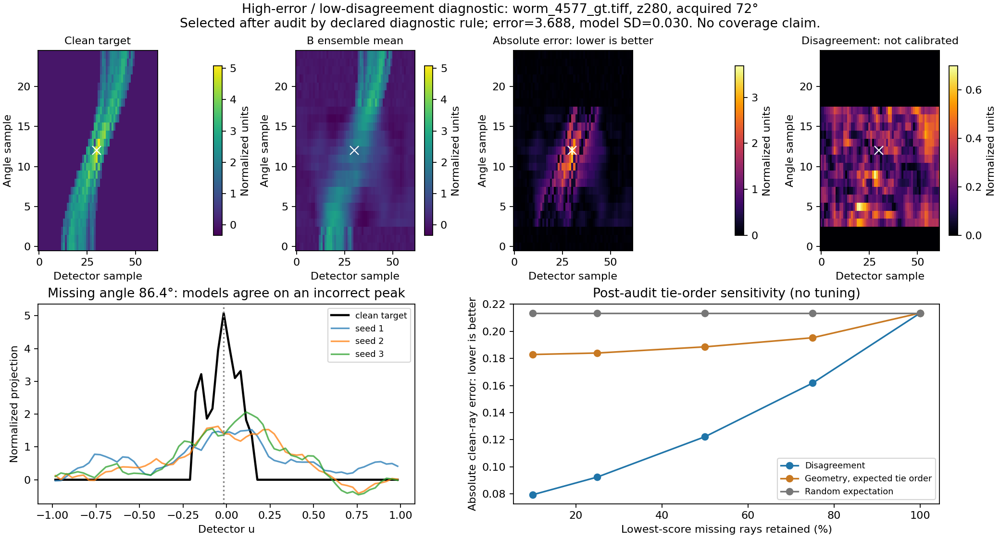
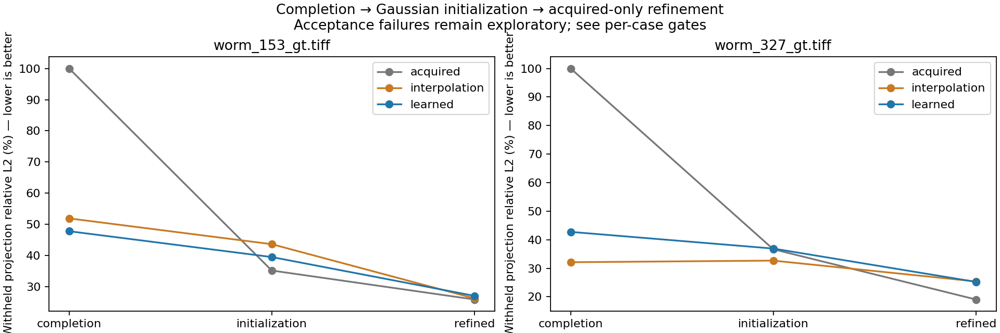
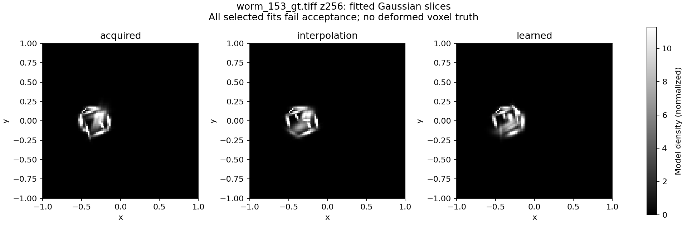

# Acquisition diversity and empirical error risk — results, 29 October 2026

The [prospective protocol](ACQUISITION_DIVERSITY_V3.md) was frozen before primary
training on 28 October; the audit and balanced Gaussian comparison completed on
29 October. All nine training runs survived the chat interruption in tmux and
finished their declared 1,000 updates. Nothing was restarted to improve an outcome.
No reserved data, new sampler, or additional training family was used.

## Reconciliation and design

The local starting checkout was clean at `ebb4754`, contrary to the prompt's older
uncommitted-state description. The old continuation note was stale. The v2 saved
metrics reproduced exactly. Its original 11-fit report remains intact; a new record
adds only the missing learned/seed 421 fit. All 12 historical starts are now present,
but the selected candidates and failed numerical gates are unchanged.

All 96 training deformations were used. The original validation numeric group 2
(12 files) selected checkpoints; group 7 (12 files) was opened for a one-time
development audit after freezing settings. All 24 reserved files remain sealed.
These groups have prior intake and partial experiment exposure and do not establish
independent deformation families or independent organisms.

The same 25×62 point-sampled sinogram grid, eight slices, fixed development scale
and 0.05 normalized noise were retained. All methods share actual acquired arrays.
Missing rays are supervised by clean training projections; completed sinograms
restore the supplied noisy measured entries exactly. The5,809-parameter CNN and
optimizer are fixed. A uses restricted masks, B broader masks with geometry, and C
broader masks with geometry channels zeroed. Every arm has three paired seeds,
batch 256 and 1,000 updates. B versus A isolates acquisition-family diversity under
these matched data/budget conditions; B versus C tests explicit geometry channels.

The40 broad training masks use13/15/17/20 measured angles. The audit separates
new mask combinations, held orientation bands, entirely held counts 16/18, and
10-angle extrapolation. Actual Boolean-mask hashes enforce separation; familiar
masks intentionally recur. All 72 distinct masks pass connectivity and measured-input
sensitivity checks. Those checks alone do not imply restoration quality.

## Completion improves with acquisition diversity

Missing clean-ray relative L2 is shown below. **Lower is better.** Values average
masks within each deformation, then deformations, then the three seeds. They are
seed-mean model scores, not scores of the averaged ensemble prediction.

| Evaluation group | Interpolation | A: restricted + geometry | B: broad + geometry | C: broad + mask |
|---|---:|---:|---:|---:|
| Selection, narrow90° /13 measured angles |63.79%|62.65%|**41.99%**|43.79%|
| Audit, narrow90° /13 measured angles |73.13%|65.89%|**41.05%**|42.80%|
| Audit, familiar acquisitions |47.40%|**28.80%**|31.40%|32.45%|
| Audit, held orientations |59.92%|44.22%|**34.99%**|37.46%|
| Audit, held counts 16/18 |56.64%|40.33%|**34.24%**|35.72%|
| Audit,72° extrapolation /10 angles |84.46%|88.35%|49.42%|**48.78%**|
| Audit, all declared masks |59.44%|45.41%|**35.57%**|37.17%|

B and C passed the frozen selection gate in all three seeds; A failed in one seed.
The executed gate compares both narrow improvement and familiar degradation against
**interpolation**, as implemented before training. It does not require B to stay
within two percentage points of A. B loses about 2.8 points to A on familiar
selection masks and would fail that alternative, stricter retention criterion.
This distinction matters when deciding whether the trade-off is useful.
B improved narrow selection errors for 10/12 deformations in every seed, and narrow
audit errors for 12/12 in every seed. The audit reduction is43.9% relative to
interpolation and 37.7% relative to A. Its narrow MSE is0.17898 versus0.58626 for
interpolation. B's narrow audit seed SD is1.84 percentage points. Averaging the
three seed errors per deformation gives a41.56% median and 45.06% worst deformation.
These describe this finite, provisionally grouped development set, not a biological
population. Per-case L2/MSE, count/span/start strata, boundary/centre errors and
paired differences are available in the CSV and JSON exports beside the plots.

Geometry conditioning has a modest measured benefit: B beats C on narrow audit
error by 1.75 percentage points and improves held orientations/counts. It does not
win universally: C is slightly better in the severe extrapolation group. A remains
best on familiar acquisitions. Broader training therefore trades some familiar-mask
accuracy for substantially better acquisition transfer; it is not a universal win.

*Shared vertical scale; smaller bars are better. Error bars show variation between
three training seeds, not confidence intervals for independent organisms.*

*Lower losses/errors are better. B's mean final-quarter training loss still fell
7.55%; the frozen plateau condition for a capacity experiment failed. A's second
seed worsened after its best selection checkpoint despite falling training loss.
Checkpoint selection preserved the earlier checkpoint. Larger capacity was not
tested, so neither its necessity nor benefit is established.*

## What the images show

The fixed example is the first audit file, worm3579, z256, first audit narrow mask
(start 57.6°, acquired span 90°). The separate worst example follows the frozen
highest seed-mean file/mask error rule. Intensity and error scales are common across
methods within each example. Display clipping does not enter quantitative metrics.

*Top: clean, acquired, interpolated and learned sinograms. Middle: magnitudes of
the detector-axis Fourier transforms at their physical angular directions in the
normalized operator coordinates. These are magnitude samples, not proof of correct
phase or restored morphology. Bottom: ramp-filter backprojections. Even clean
25-angle FBP has streaks; it is a surrogate reference, not original voxel truth.*

*White mask entries are acquired. Smaller absolute error is better. The disagreement
scale measures model variation and must not be interpreted as a calibrated error bar.*

[Worst-case views](../../../docs/figures/worm_uncertainty/acquisition_diversity_v3/worst_views.png)
and [worst-case errors](../../../docs/figures/worm_uncertainty/acquisition_diversity_v3/worst_errors.png)
retain failures rather than choosing only a visually successful slice. FBP orientation
and scale were checked using an analytic shifted, anisotropic Gaussian control.
No physical density conversion is inferred from these plots.

## Between-model disagreement is useful for ranking, with failures

The selected B ensemble averages three independently initialized models trained
with paired but seed-specific schedules/noise. Its narrow audit relative L2 is
38.95%, distinct from the 41.05% mean individual-model score above. The SD is a noisy
three-model disagreement estimate, not Bayesian posterior or total uncertainty.

The mean within-deformation Spearman association between disagreement and absolute
clean-ray error is0.458 (median0.448). Keeping the lowest-disagreement50% of missing
rays gives mean absolute error 0.1222, versus0.1878 with angular distance and 0.2135
with a fixed random ranking. Disagreement beats the angular baseline at this
retention fraction in all 12 audit deformations. These curves pool masks and slices
within each deformation; they do not treat rays as independent specimens.

*At a fixed retained fraction, lower error indicates a more useful ranking. This
is a ranking diagnostic, not coverage or an interval-calibration result.*

Angular distances have many ties. A separately labeled **post-audit sensitivity**
check averages over all tie orders instead of relying on the frozen stable order.
The geometry baseline becomes0.1886 at 50% retention; the disagreement result stays
0.1222. The advantage survives this check. No model, checkpoint, mask or gate was
changed after audit.

About0.69% of all missing rays combine top-decile error with bottom-quartile
disagreement, averaged over files. An outcome-selected failure panel identifies a
large missed peak in worm4577, z280, under 72° extrapolation: absolute error 3.688
with model SD 0.030. All three networks can agree strongly on a wrong answer.

*This is an explicitly selected failure illustration, not the predeclared fixed
example. Small disagreement cannot certify correctness, especially outside training
support. The right panel shows the additional tie-order sensitivity analysis.*

All primary errors use clean latent targets. An auxiliary analytic noisy-ray MSE
adds the known variance0.0025 to the clean MSE for an independent future noise draw
under the declared model. It supplies no empirical noisy-prediction coverage claim.

## Balanced Gaussian comparison remains exploratory

The new comparison used worm153 and worm327 from selection only, start 7.2°/span 90°,
16 components and seeds 0/81 for every arm. It completed all 12 fits within budget.
Every arm shares the acquired-only prior reference, acquired measurements, noise,
bounds, operator,450-evaluation fit cap and selection criteria. Predicted rays
enter initialization only. Component labels are centre-matched before shared
perturbations; distinct initial scenes remain distinct starts.

| Case / initializer | Completion withheld error | After Gaussian initialization | After refinement | Acquired objective after refinement | Accepted fits |
|---|---:|---:|---:|---:|---:|
| worm153 / acquired only |100.00%|35.24%|**25.96%**|28,256.3|0/2|
| worm153 / interpolation |51.95%|43.68%|26.31%|29,608.4|0/2|
| worm153 / learned ensemble |47.84%|39.56%|27.13%|31,921.5|0/2|
| worm327 / acquired only |100.00%|36.66%|**19.06%**|38,642.8|0/2|
| worm327 / interpolation |32.12%|32.68%|25.38%|40,651.0|0/2|
| worm327 / learned ensemble |42.75%|36.90%|25.22%|44,181.5|0/2|

The100% acquired-only completion error is the zero-fill diagnostic before a
Gaussian scene exists. Acquired objectives include the fixed likelihood and prior
terms; compare within a case, not across different signal energies.

In worm153, learned completion initially beats interpolation and that advantage
survives conversion to Gaussians, but refinement reverses it. In worm327, learned
completion is already worse than interpolation; conversion reduces its error, yet
refinement gives only a negligible advantage over interpolation and remains worse
than acquired-only initialization. Better average completion does not guarantee a
better initializer on every deformation.

*Lower is better. Equal starts remove the old11/12 imbalance, but all numerical
and multistart acceptance decisions fail. These are exploratory error trajectories.*

*Fitted Gaussian density at z256, shared scale. Brightness is normalized model
density, not a quality score or verified physical density. No original deformed
voxel truth is available; visual resemblance cannot certify restored3D morphology.*

Every fit is finite and feasible, but none passes all scale-aware stationarity
requirements. Only two of the 12 fits report successful optimizer termination, and
those also fail the numerical gate. A worm327 interpolation start reaches a density
bound. No accepted candidates exist for independent-start agreement. Selection
therefore uses the declared provisional lowest acquired objective, never withheld
error. All failures, start identities and acceptance components remain recorded;
thresholds were not relaxed. No accepted-refinement benefit has been demonstrated.

## Resources, provenance and checks

Host liet: Core Ultra 9 285,24 logical CPUs,62 GiB RAM, RTX 4000 Ada 20 GiB. Research
software remains Python 3.9.23, PyTorch 2.1.2+cu118 and CUDA 11.8. No research-stack
installation or sampler extension occurred. The temporary pinned Ruff 0.14.1
formatter was restored after its `/tmp` environment disappeared during interruption.

| Resource phase | Recorded time |
|---|---:|
| Training-only ingestion/profile |102.72 s|
| A, all three seeds |445.71 s|
| B, all three seeds |445.97 s|
| C, all three seeds |444.80 s|
| Additional data/noise preparation |19.18 s|
| Audit loading/inference/ensemble diagnostics |31.30 s|
| Total recorded GPU workflow phases |**24.83 min**, ceiling 100 min|
| Historical missing Gaussian fit |52.55 s|
| New12-fit Gaussian comparison |465.55 s|
| Total Gaussian CPU wall time, one thread |**8.63 min**, ceiling 30 min|

GPU workflow wall times include CPU preparation/validation; they are conservative
phase charges, not CUDA-event active-device seconds. Startup/filesystem overhead
outside phase timers and CPU figure/report work are not included. Peak training
allocation was 420.32 MiB and reservation504 MiB; cached selected slices/noise are
about 81.7 MiB. No OOM retry occurred. The filesystem reported99 GiB capacity and
about 59 GiB available; `quota -s` returned no separate quota record. New local run
artifacts occupy approximately718 MiB, with large arrays/checkpoints ignored by Git.

The full run is under `output/worm_uncertainty/acquisition_diversity_v3/`.
Protocols, executed-source ZIPs and hashes, dirty-tree state, exact masks/IDs,
cache hashes, fixed checkpoint hashes, schedules, metrics and failures are saved.
Compact exports/figures are under `docs/figures/worm_uncertainty/acquisition_diversity_v3/`.
The initial source snapshot and all historical v2 outputs remain unchanged.

**93 CPU tests pass; formatting/lint pass across 121 Python files.** Local Markdown
links, the 6,336-row metric export and both v2/v3 artifact verifiers also pass.

Targeted checks cover mask identity/holdout feasibility, reserved-access rejection,
withheld-input isolation, shared noise/schedules, balanced counts, measured-value
preservation, finite gradients, batch independence, ensemble/risk controls,
acquired-only fit selection, start intersections and FBP orientation/scale. The
read-only verifier regenerates every per-case metric and primary risk curve, checks
executed-source archives and checkpoint selection, and verifies downstream arrays.

## Limitations and smallest next experiment

The positive conclusion is acquisition generalization of deterministic supervised
completion within this synthetic organism's development deformations. Explicit
geometry adds a modest, nonuniform benefit. Disagreement is a useful empirical risk
ranking in this audit, with clear false reassurance cases. Neither is calibrated
Bayesian inference. Larger capacity remains untested. The Gaussian reconstruction
result remains inconclusive because every fit fails acceptance and useful completion
sometimes deteriorates during refinement. Physical scaling, original voxel truth,
deformation genealogy and independent-organism transfer remain unresolved.

The smallest justified next experiment is one selection-case **objective-path
diagnostic** using the saved learned/interpolation initialized and refined Gaussian states:
decompose acquired residual and prior penalties while tracking the difference in
withheld error along paired feasible parameter paths. It can test whether the objective rewards losing the initialization's
prediction benefit before changing priors, representation or optimizer settings.
The path would be a diagnostic, not the optimizer's actual trajectory. Do not launch
another network family, sampler or larger reconstruction sweep by default.
