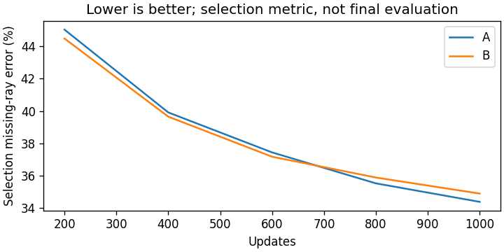

# Week 8 paired FBP-loss ablation — 16 November 2026

Completed one paired seed, two arms,1000 updates each. Frozen protocol and source
hashes are in docs/results/worm_uncertainty/bridge_ablation_v1. Original V3 CNN,
broad masks, training96 files, noise banks, optimizer and batch256 were reused.
Both arms used32-example microbatches with identical accumulation and schedules.
Selection retains the original12-file/18-mask missing-ray criterion. Lambda
264.148468 came from a separate training-only batch scale check before outcomes.
The auxiliary target is an FBP surrogate with identical measured noise, not voxel truth.

Evaluation: first3 original V3 audit deformations, starts64.8° and136.8° at90°,
and64.8°/120° control. These deformations were previously audited; masks were
previously inspected on different bridge deformations. This is development evidence.
No reserved outcomes. Same measured values, operator and FBP weights across arms.

| Narrow-mask method | Withheld reprojection error | Acquired residual |
|---|---:|---:|
| Interpolation + FBP |56.65%|13.03%|
| SART |37.95%|15.88%|
| A: missing-ray loss + FBP |37.39%|12.98%|
| B: added FBP surrogate loss |37.27%|12.89%|

B improves by only0.12 percentage points versus A and wins on1/3 deformations.
The frozen gate requires2 points and a majority, with no more than1 point worse
acquired residual. **Gate failed.** Both models are close to SART on withheld
error; the small differences do not establish superiority. No second seed, lambda
sweep or new model is launched after this negative result. No worm voxel claim.



The paired runs completed with finite gradients; all selected checkpoint hashes
were verified before evaluation. Each arm retains one selected checkpoint. Actual
runtime and peak allocated/reserved memory are in the exported arm reports.
The differentiable FBP and V3 tests pass; formatting/lint pass. Full smoke-based
validation is not a claim of numerical reconstruction optimality.

Commands (fresh default output destinations required; existing runs refuse overwrite):

```bash
PY=output/worm_uncertainty/alternative_reconstruction_sources/env/bin/python
OPENBLAS_NUM_THREADS=1 OMP_NUM_THREADS=1 $PY -m experiments.worm_uncertainty.studies.train_bridge_ablation
OPENBLAS_NUM_THREADS=1 OMP_NUM_THREADS=1 $PY -m experiments.worm_uncertainty.studies.evaluate_bridge_ablation
```

The specific default run is already complete; do not rerun without changing the
output ID prospectively. DuDoNet primary-source inspection remains incomplete
because publisher access returned403; this implementation follows the user-specified
FBP surrogate and does not claim reproduction of DuDoNet.
