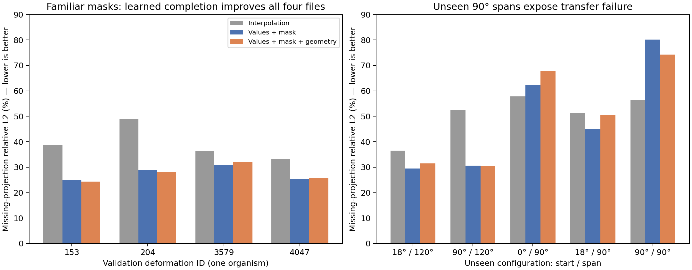
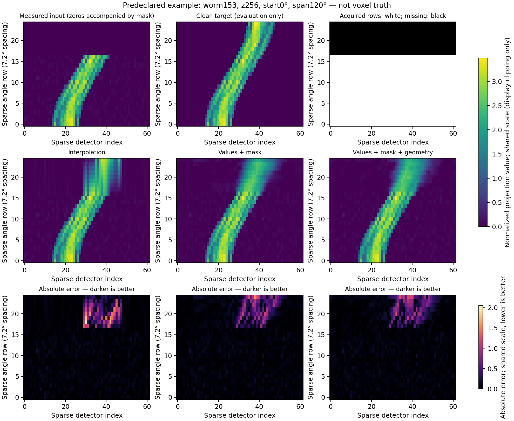
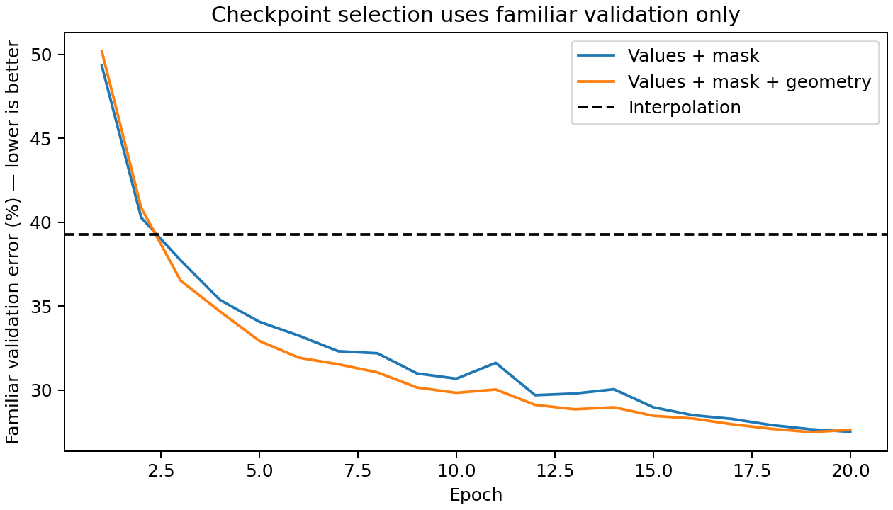
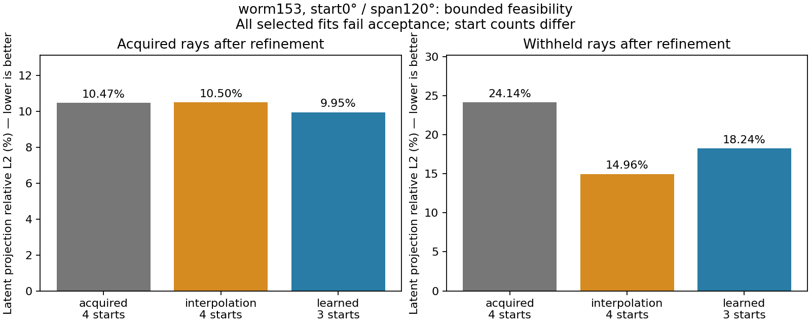

# Matched-input restoration results — 28 October 2026

This completes the first training comparison under the [frozen v2 design](COMPLETION_MATCHED_V2.md).
The original [preparation protocol](COMPLETION_PROTOCOL.md) and failed posterior
experiments remain historical evidence. No reserved-deformation outcomes were read.

## What was matched

The inherited Gaussian grid uses TIFF angle indices 0,4,…,96, detector indices
2,7,…,307 and eight axial planes 224:8:280. These are point samples, not averages.
All arms receive the same noisy acquired values, mask and fixed development scale
6180.275452553537. Noise SD is 0.05 after normalization. Completion targets are
clean projections, not voxel-density truth. A full underlying noise field is
subsampled consistently; no extra measured rays enter either learned arm.

The four-layer CNN has 5,809 nominal parameters and a 31-row angular receptive
field on the 25-row grid. Connectivity and nonzero input-gradient tests pass for
all intended masks, including 90° spans. They establish access to measurements,
not successful inference of hidden structures. The mask-only arm zeros five geometry
channels, leaving 720 first-layer weights without a data gradient. Interpolation
uses the parallel-beam detector reversal at 180°; the CNN uses zero padding.

Roles remain 96/24/24 deformations, with the original 16/4/4 pilot subset. Only
16 training and four validation files were used. Numeric-ID grouping is provisional;
these are deformations of one synthetic organism, not independent specimens.

## Completed training and validation

Both arms completed 20 epochs and 2,560 updates with the same seed, Adam settings,
shuffle and noise. Mask-only training took 27.21 s; geometry training took 23.77 s.
Peak PyTorch allocation was 68.43 and 68.48 MiB respectively. Total loading,
training and evaluation took 74.44 s (process peak RSS 1.26 GiB) on liet, RTX 4000
Ada, Python 3.9.23 / PyTorch 2.1.2+cu118. No 20-minute time cap was reached.
Best checkpoints were epochs 20 and 19, selected only on familiar acquisitions.

| Method | Familiar missing relative L2 | Familiar normalized MSE | Unseen-mask relative L2 | Unseen-mask MSE |
|---|---:|---:|---:|---:|
| Zero fill | 100% | 1.02794 | — | — |
| Detector-reversal interpolation | 39.29% | 0.17440 | 50.90% | 0.27991 |
| Measured values + mask | 27.51% | 0.07744 | 49.53% | 0.29033 |
| Measured values + mask + geometry | **27.49%** | **0.07692** | 50.91% | 0.29804 |

Lower is better for both errors. Familiar results average within each file across
eight masks, then across four files; slices are not treated as independent trials.
The geometry arm passed the frozen progression rule: 30.04% relative improvement
over interpolation, all four files improved, and MSE improved. Its 0.022 percentage
point advantage over mask-only is too small, with one seed, to establish a benefit
from geometry conditioning.

| Validation deformation | Interpolation | Mask only | Geometry |
|---|---:|---:|---:|
| 153 | 38.59% | 25.11% | 24.36% |
| 204 | 49.02% | 28.83% | 27.93% |
| 3579 | 36.33% | 30.71% | 31.99% |
| 4047 | 33.21% | 25.39% | 25.67% |



*Lower missing-ray errors are better. Per-file pairing supports a familiar-mask
restoration benefit; the acquisition-shift panel shows its limits.*

After checkpoint and arm selection were frozen, unseen masks were evaluated only
on the same validation deformations. No tuning followed these outcomes.

| Unseen start / span | Interpolation | Mask only | Geometry |
|---|---:|---:|---:|
| 18° / 120° | 36.50% | 29.45% | 31.54% |
| 90° / 120° | 52.41% | 30.67% | 30.33% |
| 0° / 90° | 57.79% | 62.24% | 67.91% |
| 18° / 90° | 51.34% | 45.07% | 50.56% |
| 90° / 90° | 56.45% | 80.21% | 74.22% |

New starts at 120° improve, but narrow-span transfer is unreliable. The selected
geometry model does not beat interpolation on the pooled unseen masks and has
higher MSE. Verified angular context did not ensure generalization. Even familiar
masks are not uniformly improved: interpolation wins at start 36°/span 144°.



*Predeclared worm153, z256, start0°/span120°. Common intensity and absolute-error
scales permit comparison; smaller absolute errors are better. Display clipping
does not affect metrics. Acquired values are preserved exactly in every completion.*



*Selection uses familiar-validation relative L2, not the unseen-mask outcomes.*

## Artifact integrity and preserved failure

The first integration attempt stopped before any fit: the saved `mask` metadata
key had been overwritten by predictions from the arm also named `mask`. Training,
checkpoint selection and in-memory metrics were unaffected. Future writes use
`acquired_mask`; the reader reconstructs historical masks from frozen acquisition
identities and verifies new metadata when present. A regression test covers both.

Original training artifacts were not rewritten or retrained. Recomputed per-file,
per-mask and pooled metrics match every stored number exactly, and measured values
match the deterministic observation constructor and all completed arrays bitwise.
A derived repair directory retains explicit masks and the exact executed trainer
and data-helper sources. The failed `completion_refinement_v2` and log remain;
the actual fits use the fresh `completion_refinement_v2_retry1` directory.
The read-only verification command is:

```bash
python -m experiments.worm_uncertainty.studies.verify_matched_completion
```

## Independent inference feasibility

A fixed-metric Metropolis-adjusted Langevin proposal was tested independently of
restoration. Coordinates are affine-whitened by the saved local covariance factor;
the constant Jacobian cancels. Exact nonlinear gradients and forward/reverse
proposal densities preserve the original bounded target; invalid proposals are
rejected, not clipped. This is sampling, not conditional density MAP replacement.
See [MALA methodology](https://eprints.lancs.ac.uk/68619/1/1402.0694.pdf).

A separate elongated tuning case chose step 0.1 from 0.01/0.03/0.1 using acceptance
and accepted movement only. Settings were saved before two evaluation cases.
Four chains per case used 200 warmup + 500 retained iterations, including an
alternative fitted initialization. One CPU thread completed the study in 167.73 s,
within the 600-second budget. Scalar bounded and correlated linear-Gaussian controls
passed; affine gradients agree with finite differences.

| Case | Maximum rank/folded Rhat | Minimum bulk ESS | Minimum tail ESS | Decision |
|---|---:|---:|---:|---|
| Moderate, start14.4° | 2.438 | 4.91 | 10.92 | Fail |
| Elongated, start72° | 5.947 | 4.13 | 0 | Fail |

The declared requirements were Rhat ≤1.01 and bulk/tail ESS ≥400 over parameter
coordinates and meaningful density/projection outputs. Diagnostics follow
[rank normalization, folding and tail ESS](https://arxiv.org/abs/1903.08008), with
local scalar/control checks rather than an external sampler-library certification.
Moderate acceptance was 94–97%, yet mixing failed. Two elongated chains accepted
no moves; no proposal violated bounds. High acceptance or physical validity alone
therefore does not establish useful posterior sampling. No calibrated intervals
are reported, and sampler expansion is paused. Earlier importance/truncation and
random-walk failures remain unchanged.

## Limits and next development decision

These are deterministic supervised synthetic results with one training seed and
four validation deformations. They support familiar-acquisition completion, not
reserved-deformation generalization, physical-density accuracy or calibrated
uncertainty. Projection scaling and original deformed voxel truth remain unresolved.

A future development amendment should address the observed narrow-span failure
with a predeclared training-mask change and unchanged held-out acquisition tests,
then freeze a separate reserved evaluation. Do not tune on the existing shift
outcomes and continue describing them as untouched tests. First interpret the
bounded Gaussian initialization result below; no larger sweep is authorized.

## Bounded Gaussian initialization result

The declared worm153 / start 0° / span 120° comparison finished in **577.77 s** with
829 MiB peak RSS. Its 600-second guard stopped before the twelfth fit: acquired
and interpolation each have four starts, learned has three. The initial estimate
was 662.71 s for all 12 fits; the budget was not extended. This is an incomplete,
unbalanced multistart feasibility comparison, not a completed matched ranking.

| Initialization | Completed starts | Acquired latent error after refinement | Withheld latent error after refinement | Acceptance |
|---|---:|---:|---:|---|
| Acquired-only dictionary | 4 | 10.47% | 24.14% | Fail |
| Interpolation dictionary | 4 | 10.50% | 14.96% | Fail |
| Learned completion dictionary | 3 | 9.95% | 18.24% | Fail |

Before refinement, missing-ray error was 40.58% for interpolation and 31.26% for
learned completion on this case. Both corresponding refined fits reduce these
errors, but the learned advantage over interpolation is erased and reversed.
Both completion initializers provisionally outperform the acquired-only result.
The learned fit has the lowest acquired error, yet interpolation has the lowest
withheld error; fitting measured rays better does not ensure better restoration.

Every arm used identical noisy acquired observations, sigma, 16 components,
450-evaluation per-start budget, bounds and **acquired-only geometry-prior reference**.
Predictions entered initialization only. Shared seed perturbations were applied
after centre-based component alignment; differing initial scenes are not identical
starts. Selection used converged candidates and acquired objective, never withheld
error. The learned arm selected its single converged candidate (seed 81); the others
had no converged candidates and retain provisional lowest-objective fits.

All multistart gates fail, and all selected fits fail the scale-aware numerical
rule. The learned candidate's optimizer success does not override its numerical
failure (prior-scaled correction 0.001236). All 11 candidates, including failures,
are saved. Neither optimizer success nor these projection errors establishes
accurate density or posterior calibration. No extra starts, iterations or reserved
integration were launched.



*Lower errors are better. All selected fits fail acceptance; 4/4/3 start counts
and a single familiar validation case prevent a reliable method ranking.*

Compact training, sampler and refinement summaries with source/artifact hashes
are stored beside these figures. The full arrays and checkpoints remain in ignored
output directories listed in the continuation note. Read-only verification checks
hashes, exact acquired arrays, per-file/mask metrics and checkpoint selection.
