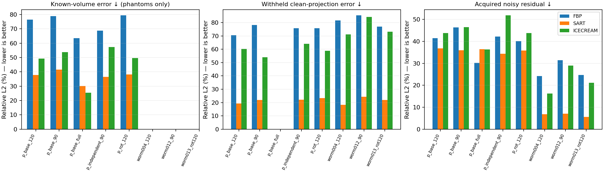
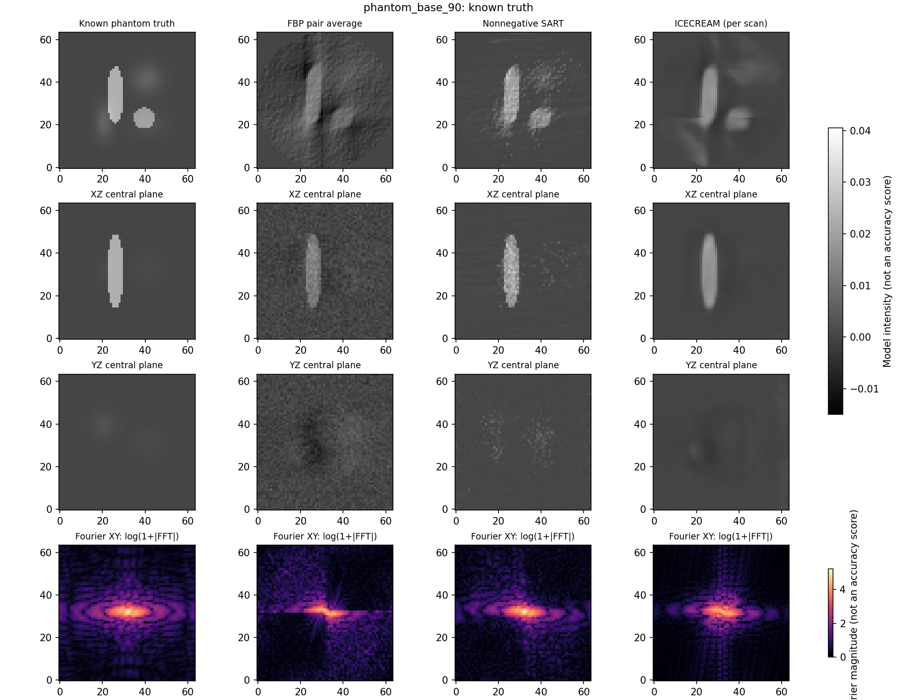
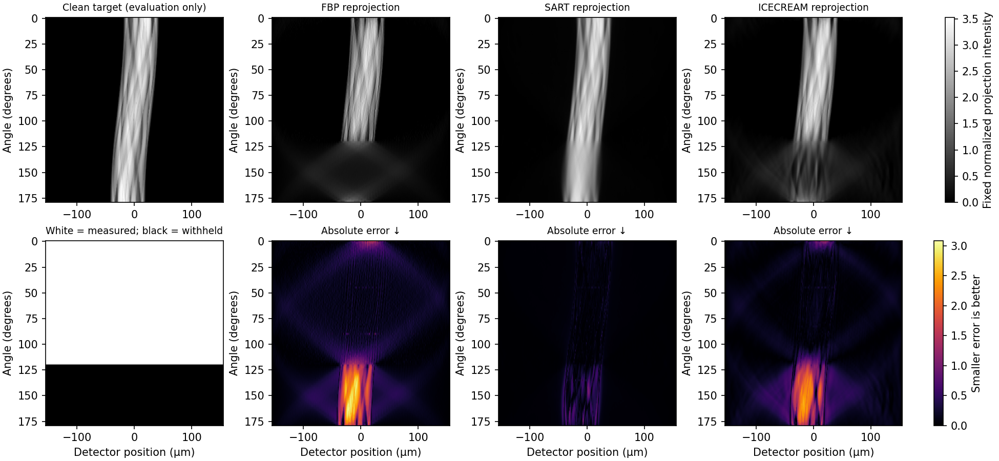
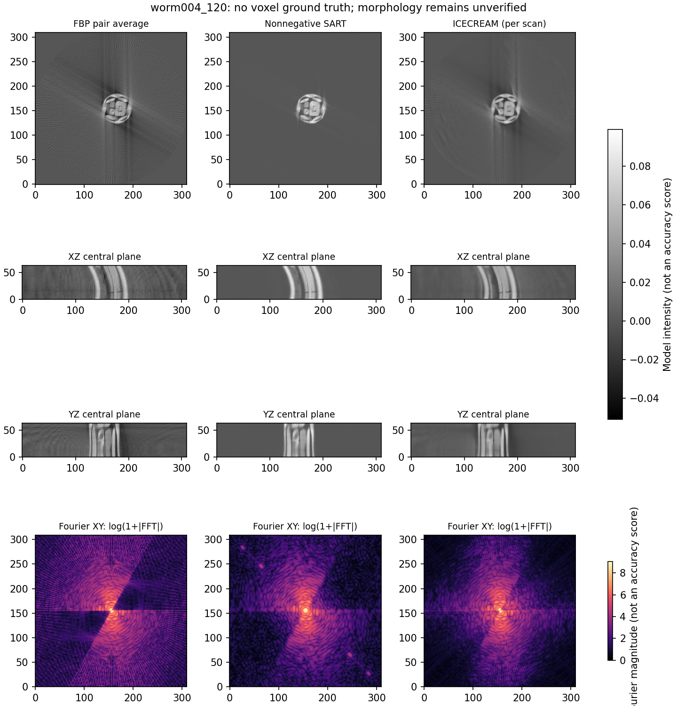
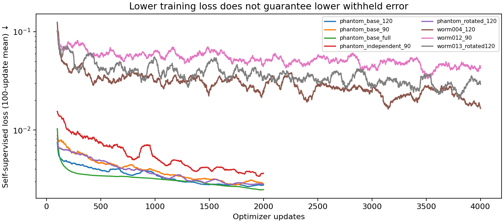

# Alternative reconstruction pilot — 10 November 2026

## Purpose and interpretation

The previous completion CNN improved missing projections, but all 12 balanced
Gaussian fits failed numerical acceptance. This motivated a direct voxel
reconstruction comparison. It does not show that Gaussian representations cannot
work. The [frozen design](ICECREAM_PILOT_V1.md) declares five phantom acquisitions
and three development worm acquisitions. The 24 reserved deformations remain unused.

This is an **adaptation of ICECREAM for per-acquisition self-supervised CT
reconstruction**, not a reproduction of the paper's cryo-ET experiment. We directly
use its pinned original 16.3-million-parameter network, unmodified cross-pair and
equivariant loss, and double-pass inference expression. Necessary changes cover CT
axes and wedge construction, cubic rotations, fixed intensity scaling, contiguous
patches and streaming inference. See the protocol for the exact distinctions.

Every method receives the same two independently noisy acquired sinograms.
FBP and five-sweep nonnegative SART use their average. Each observation has noise
SD 0.05 in the inherited normalized projection scale; averaging gives SD 0.03536.
The clean missing rays and phantom volumes are evaluation-only. Training uses a
fixed final checkpoint, never withheld error. No method receives clean acquired
training targets. The original 100-angle/310-detector worm grid is used, so these
scores are not directly comparable with the historical sparse completion study.

## Checks and important mismatch

The new pixel-driven CT projector has an exact discrete transpose. Its adjoint
inner-product relative error is 1.34e-16; the 180-degree detector reversal error is
1.12e-15. An independent shifted anisotropic Gaussian has 0.95% analytic projection
error, 5.49% full-angle FBP volume error, scale ratio 0.987 and centroid error
0.135 pixels. These tests support our implementation, not identity with the worm
simulator, whose exact projection scaling remains unresolved.

ICECREAM uses an idealized Fourier wedge, not this CT operator. Before training,
we compared these on separate known volumes. For the smooth object, limited-angle
FBP versus the configured Fourier operator differs by 45–51% globally; the mixed
object differs by 35–45%. Crop/operator noncommutation is 12–27% in the tested
limited-angle cases. The upstream real-mask symmetrization also broadens some
low-frequency wedge boundaries. These approximations are preserved and disclosed.
They prevent attributing a negative result solely to network capacity or learning.

The first worm's acquired FBP has an axis-gradient-energy ratio of 3.35. This does
not support assuming rotationally invariant patches; the measurement wedge itself
also creates anisotropy. We have not separated object and acquisition anisotropy.

## Results

Relative L2 errors below are percentages; lower is better. Acquired residual is
against the noisy pair average, so fitting that noise more closely need not improve
volume truth. Full-angle ICECREAM is explicitly an N2N-only positive control:
its equivariance weight is zero because there is no missing wedge.

| Phantom acquisition | Method | Volume error | Withheld error | Acquired residual |
|---|---|---:|---:|---:|
| Base, full | FBP | 63.42 | — | 30.22 |
| | SART | 30.13 | — | 36.42 |
| | ICECREAM/N2N | **25.50** | — | 36.29 |
| Base, 120° | FBP | 76.41 | 70.49 | 41.51 |
| | SART | **37.80** | **19.30** | **36.82** |
| | ICECREAM | 49.24 | 60.31 | 43.80 |
| Base, 90° | FBP | 78.77 | 78.26 | 46.33 |
| | SART | **41.65** | **21.98** | **35.94** |
| | ICECREAM | 53.69 | 53.90 | 46.43 |
| Independent, 90° | FBP | 68.69 | 75.84 | 42.22 |
| | SART | **36.50** | **22.11** | **34.41** |
| | ICECREAM | 57.24 | 64.05 | 51.84 |
| Rotated acquisition, 120° | FBP | 79.39 | 75.72 | 40.06 |
| | SART | **38.25** | **23.40** | **35.80** |
| | ICECREAM | 49.53 | 58.84 | 43.84 |

ICECREAM improves on FBP for all four limited-angle phantom cases but does not beat
SART in volume or withheld-projection error. Its acquired residual is also higher
than SART's. The full-angle denoising control improves volume error, showing a useful
denoising effect without demonstrating missing-wedge recovery. Noise is substantial
relative to the small phantom signal; this is one declared noise level, not a noise
robustness study.

The saved upstream `method.json` retains default `config.seed=42` and
`config.iterations=50000` fields, but its original training loop is not called.
The adapter explicitly seeds initialization/rotations/crops with **2026111001**;
`input_contract.json`, `training_freeze.json` and the completed loss rows record
the effective 2000/4000-update loop. The effective settings, not these unused
upstream defaults, define the experiment.

## Completed worm comparison

All three fixed 4000-update FP32 runs completed. These use the same observed pairs
as FBP/SART, with no withheld checkpoint selection. Start and acquired span are
shown separately; the omitted angular wedge is 180° minus the acquired span.
There is no worm voxel error because matching simulator voxel truth is unavailable.

| Worm: start/acquired span | Method | Withheld error (%) | Acquired residual (%) | Train + inference (s) | GPU peak (GiB) |
|---|---|---:|---:|---:|---:|
| worm_004, 0°/120° | FBP | 81.58 | 24.22 | 1.9 | 0.00 |
| worm_004, 0°/120° | SART | 18.25 | 6.77 | 10.7 | 0.00 |
| worm_004, 0°/120° | ICECREAM | 71.09 | 16.27 | 564.7 | 1.34 |
| worm_012, 0°/90° | FBP | 85.40 | 31.48 | 2.2 | 0.00 |
| worm_012, 0°/90° | SART | 24.29 | 7.09 | 10.4 | 0.00 |
| worm_012, 0°/90° | ICECREAM | 84.28 | 29.02 | 563.7 | 1.34 |
| worm_013, 36°/120° | FBP | 77.01 | 24.68 | 2.2 | 0.00 |
| worm_013, 36°/120° | SART | 21.95 | 5.58 | 12.6 | 0.00 |
| worm_013, 36°/120° | ICECREAM | 73.15 | 21.18 | 564.7 | 1.34 |

SART has the lowest withheld error in all three worm acquisitions. The finite-network and operator tests passed, but this pilot
has not established a reliable learned reconstruction advantage. Changed deformation
and acquisition are confounded in these three cases; this is not an isolated
estimate of orientation generalization.



*Lower volume/withheld error is better. A lower noisy acquired residual measures
fit to observations, not necessarily accurate density.*



*Fixed central planes at common scales. ICECREAM smooths noise but blurs edges and
retains artifacts. Smooth appearance and Fourier energy are not accuracy measures.*



*White in the mask means measured; black means withheld. Common absolute-error
scales show the missing-angle defect in FBP and ICECREAM. SART predicts these rays
more accurately for this case.*



*These are reconstructions, not voxel references. Agreement or sharp appearance
cannot establish biological accuracy without corresponding simulator volumes.*



*Moving averages of acquired-only self-supervised loss. Finite training and declining
loss do not establish convergence, accurate missing rays or posterior calibration.*

## Numerical failure retained

The first worm AMP attempt failed after six accepted updates with nonfinite
gradients. Its failed checkpoint and report remain in `runs/worm004_120`.
Unscaled AMP and FP32 gradients were finite at the diagnostic crop. A separate
16-update FP32 smoke passed. This is consistent with loss-scaling overflow, though
not a complete causal diagnosis. One prospectively documented FP32 attempt uses
the same 4000 updates, seed, patch, inputs and time limits for each planned worm.
No outcomes selected this amendment; it has a separate hash and output namespace.

## What this pilot does not establish

- Short per-scan training is much smaller than the paper's 50,000 iterations with
  batch size eight. Failure at our budget does not disprove the original method.
- Three development deformations are not independent organisms or a reserved test.
- Worm voxel truth, physical path-length scaling and simulator/operator identity
  remain unresolved. Worm projections allow predictive evaluation, not proof of
  accurate morphology or physical density.
- Training uses fixed central 128×128 lateral regions within 64 contiguous axial
  planes; inference covers the full 310×310 support. This is a local slab pilot,
  not a complete-worm validation.
- One training seed and one noise pair per acquisition do not measure between-run
  reliability. Different acquisitions also change deformation, so their effects
  cannot be separated causally.
- The model is not explicitly constrained nonnegative. Common circular support is
  applied equally at evaluation; raw outputs and outside-support energy are saved.
- No calibrated uncertainty or posterior intervals are supplied.

## Decision and smallest next experiment

The conditional unrolled pilot is deferred because the primary experiment exposes
substantial Fourier/discrete-CT mismatch that should be isolated first. No unrolled
result is claimed. No new sampler or Gaussian sweep was run.

The smallest useful next experiment is a matched known-volume operator control:
keep the object, noise, network, loss and fixed training budget unchanged, and compare
inputs generated by the declared Fourier operator with CT-FBP inputs. Freeze a
single limited-angle case and report both volume and CT-projection errors. This
would test whether the input/operator mismatch contributes to failure before
spending more time on architectures. It is a proposed new protocol, not launched.

## Future DeepDeWedge feasibility

DeepDeWedge is not run here. Its pinned BSD-2-Clause code is
`072075692a44a8f17394214369e6e762abe52bc3`. A fair later comparison would reuse these
same noisy pairs, contiguous isotropic slabs and evaluation projector. Its suggested
minimum 64-voxel patches need a new memory/throughput smoke; our 64-plane slab has
no axial room for arbitrary larger crops. Its iterative input refinement and
rotation-based artificial wedge corruption differ from ICECREAM's equivariant loss.
Do not infer a reliable runtime from ICECREAM's timing: prospectively budget a
five-minute smoke, then set update counts within a separate approved training cap.
The same Fourier/CT and patch-distribution assumptions require checking.

The efficient-unrolling repository was inspected at
`285c20600c6348fa1a4bf99754b0ace8fd72f877`; the pinned tree contains no license grant.
No code was copied. A small exact-operator unrolled network would be an inspired
control, not a reproduction of its partitioning and normal-operator approximation.

## Primary references

- [ICECREAM: original method, loss and inference](https://journals.iucr.org/d/issues/2026/04/00/zi5009/).
- [ICECREAM official implementation](https://github.com/swing-research/icecream/tree/39c891a55af3e1cd96ef0d585668b0c2af4c177d).
- [DeepDeWedge](https://doi.org/10.1038/s41467-024-51438-y).
- [Efficient Unrolled Networks for Large-Scale 3D Inverse Problems](https://arxiv.org/abs/2601.02141).

## Environment and exact commands

The dedicated environment is
`output/worm_uncertainty/alternative_reconstruction_sources/env`: Python 3.11.18,
PyTorch 2.8.0+cu126 on liet's RTX 4000 Ada (20 GB). The old Gaussian environment
remains unchanged. The [installed-version lock](../protocols/icecream_environment_20261110.txt)
records dependencies. The new environment occupies about 6.3 GiB; the pilot artifacts occupy about
1.4 GiB, with roughly 51 GiB free on the shared filesystem. Raw data and
checkpoints are ignored by Git. CPU stages use two PyTorch threads and one BLAS
thread. The GPU was checked for other compute jobs and kept well below available
VRAM; model size was not increased to fill memory.

Verification and fresh figure export, without retraining:

```bash
cd ~/espaces/travail/trdp2/r2_gaussian
source ~/espaces/travail/trdp2/tools/miniforge3/etc/profile.d/conda.sh
conda activate "$PWD/output/worm_uncertainty/alternative_reconstruction_sources/env"
export OPENBLAS_NUM_THREADS=1 OMP_NUM_THREADS=2
export MPLCONFIGDIR=/tmp/cache-mdzislam/matplotlib
python -m experiments.worm_uncertainty.studies.verify_icecream_pilot
python -m unittest experiments.worm_uncertainty.tests.test_alternative_reconstruction
make check PYTHON=python
python -m experiments.worm_uncertainty.plots.plot_icecream_pilot \
  --output output/worm_uncertainty/icecream_figures_recheck
```

The figure destination must be new. Training reproduction is optional and repeats
completed work; it is not the proposed next scientific experiment. Check `nvidia-smi`
and launch inside tmux using a fresh root:

```bash
tmux new-session -s icecream-reproduction
bash experiments/worm_uncertainty/studies/reproduce_icecream_pilot.sh \
  output/worm_uncertainty/icecream_pilot_v1_reproduction
```

This uses the original frozen budget and the documented FP32 worm amendment,
without deliberately repeating the failed AMP attempt. Allow about 45 minutes of
GPU execution plus CPU preprocessing/verification on liet; ceilings are unchanged.
The source script passes `bash -n`; this duplicate training was not launched.
Fixed seeds define the experiment, but bitwise GPU reproducibility across different
hardware/software versions is not promised.

For a fresh machine, clone the official code into
`output/worm_uncertainty/alternative_reconstruction_sources/icecream`, check out
`39c891a55af3e1cd96ef0d585668b0c2af4c177d`, and create a separate Python 3.11.18
environment at the path above. Install the version lock with
`python -m pip install --extra-index-url https://download.pytorch.org/whl/cu126 -r experiments/worm_uncertainty/protocols/icecream_environment_20261110.txt`.
The adapter imports the pinned checkout directly; no installation into the old
Gaussian environment is needed. Keep the original frozen artifacts for reproducing
this exact budget and numerical amendment.

## Completed execution and checks

Five phantom and three worm acquisitions finished; the separate AMP failure is
retained. Training/inference child-process wall time, including that failure, was
**41.91 minutes**. The training-only profile took 5.59 seconds and the
FP32 smoke's 16 updates took 2.28 seconds; its two diagnostic backward evaluations
are additional short checks. Allow approximately 45 GPU minutes for the complete
milestone, far below the 180-minute ceiling. These are wall-time measurements,
not integrated GPU utilization. Peak training allocated memory was
**1.34 GiB**; peak reserved memory was about 1.49 GiB.

The CPU was an Intel Core Ultra 9 285; two PyTorch threads and one BLAS thread
were used. Preparation/evaluation timings and per-method memory are recorded in
[the compact artifact export](../../../docs/results/worm_uncertainty/icecream_pilot_v1/summary.json)
and [metric CSV](../../../docs/results/worm_uncertainty/icecream_pilot_v1/metrics.csv).
Full checkpoints, arrays, source snapshots and failures remain in the ignored
`output/worm_uncertainty/icecream_pilot_v1` directory.

All 10 targeted tests pass. Existing-environment discovery previously passed
99 tests with the isolated-ICECREAM test class skipped; all four of that class's
tests pass in the dedicated environment. Formatting/lint covers 134 Python files.
The final artifact verifier regenerates all eight cases' metrics and checks source
archives, checkpoint/input hashes, mask/noise identity, withheld isolation, fixed
update counts and common support. No reserved case was accessed.
