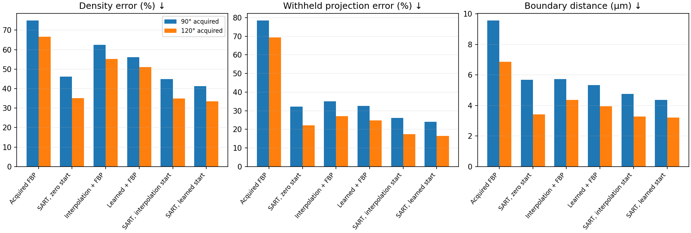
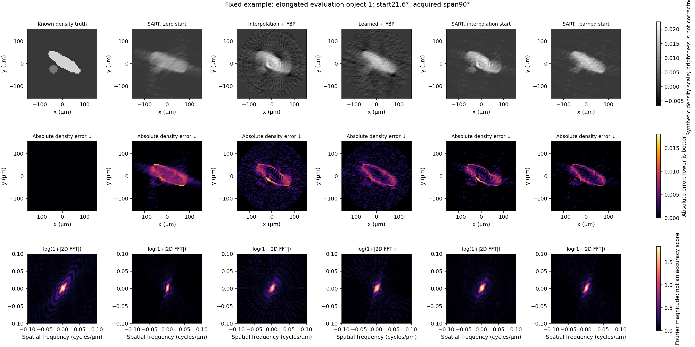
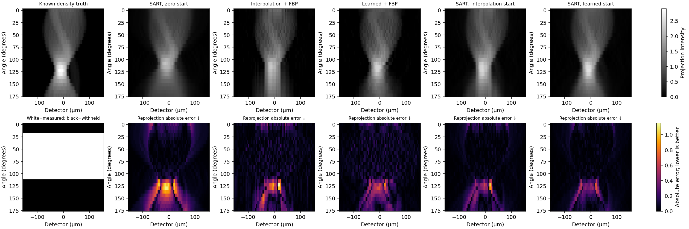

# Week 8 — known-density phantom benchmark, 16 November 2026

## Outcome

A learned completion prior improved known **2D slice density** after measured-only
SART refinement under this controlled matched-operator simulation. It did not remove
missing-angle ambiguity. The held-out objects still have substantial density error;
this is not a 3D worm, physical-density or uncertainty-calibration result.

The [frozen protocol](../protocols/phantom_density_v1.json) preceded synthetic
calibration, training and evaluation. Starting repository HEAD26cf9d6 retained the
uncommitted Week8 changes. The runner archived executed sources and dirty state.
No raw worm file, reserved outcome, new sampler, ICECREAM or Gaussian fit was used.

## Why this experiment

The preceding worm FBP-loss ablation failed its2-percentage-point/majority gate.
Withheld projection accuracy alone could not tell us whether density or edges were
correct. This experiment therefore supplies known density and evaluates the same
completion architecture with its ordinary missing-ray MSE. It does not repeat a
lambda sweep or train on worm surrogate reconstructions.

## Frozen setup and fairness

- 128 independently seeded training objects,16 selection objects and12 evaluation
  objects; no object seed repeats. Smooth blobs, elongated sharp objects, shells
  and heterogeneous interiors occur in all three splits. These are held-out
  objects from shared generator classes, not held-out shape families or organisms.
- V3-style sparse geometry:25 angles0:7.2:172.8°,62 detectors at5µm spacing and
  symmetric centres,62×62 reconstruction pixels at5µm. Every object is a separate
  2D density slice. Sparse samples are generated directly by the verified discrete
  projector; they are not detector-bin averages. We do not claim to reproduce the
  worm simulator's unknown projection scale or its dense noise field exactly.
- Fixed amplitudes0.008–0.018 model-density units plus declared inclusions; no
  normalization estimated from evaluation. Independent noise SD0.05 is generated
  before masking on the complete sparse grid. Every arm receives identical noisy
  acquired values, copied bitwise into completed sinograms. Targets are clean.
- Original5809-parameter CNN; supervised missing-ray MSE, Adam0.001, batch64,
  2000 updates, one seed850001. Eight training noise banks and balanced V3 broad
  mask counts13/15/17/20. The16-object/four-mask selection score chooses the lowest
  missing-ray relativeL2, with first-checkpoint tie breaking. Update2000 was selected;
  the curve was still improving, so convergence is not claimed.
- Evaluation masks: familiar start0° with spans90°/120°, and unseen training
  orientations21.6°/100.8° at90°/120°. Selection masks are disjoint from these
  actual Boolean masks. All12 objects are evaluated at all six masks.
- FBP uses exactly the same ramp, scale and7.2° quadrature for both completed arms.
  Acquired-only FBP omits missing angular contributions without pi/span gain.
  Nonnegative SART has five sweeps, relaxation0.5 and identical circular support.

The prospective gate required at least2 points lower mean90° density error than
interpolation+FBP, improvement on a majority of objects and at most1 point worse
acquired residual. **It passed:**6.33 points lower density error,12/12 object wins,
and0.03 points higher acquired residual. Learned+FBP remained worse than acquired-only
SART in density error. Consequently the declared initialization-only test ran.

For refinement, both completed-FBP initializers are clamped nonnegative within the
same support, then receive the same five acquired-only SART sweeps as zero-start
SART. Predicted missing rays never enter SART updates. Equal iteration counts match
refinement effort, not total end-to-end compute: learned initialization also costs
network training/inference. Early stopping means an advantage may reflect a better
starting point rather than a different converged solution.

## Results: density, projections and edges

RelativeL2 values are percentages; lower is better. Metrics aggregate masks within
object, then objects equally. Rays and repeated masks are not independent samples.

| 90° acquired span | Density error | Withheld reprojection error | Acquired residual | Boundary distance (µm) |
|---|---:|---:|---:|---:|
| Acquired FBP |74.90|78.40|36.60|9.56|
| SART, zero start |46.10|32.31|12.97|5.70|
| Interpolation + FBP |62.52|35.02|10.38|5.74|
| Learned + FBP |56.19|32.53|10.41|5.34|
| SART, interpolation start |44.94|26.22|11.39|4.75|
| SART, learned start |**41.37**|**24.05**|11.24|**4.36**|

Learned-initialized SART improves density by4.74 points over zero-start SART
(11/12 object wins) and3.57 points over interpolation-initialized SART
(10/12 wins). It also reduces interior MAE0.00338→0.00283 and boundary distance
5.70→4.36µm versus zero start. Signed interior bias remains negative:
−0.00193 model units. Underestimated density and blurred edges remain.

The projection and density rankings are distinct: learned+FBP and zero-start SART
have similar withheld error (32.53% versus32.31%), but their density errors are
56.19% versus46.10%. This directly demonstrates why the worm projection score
cannot establish voxel accuracy. The lower FBP acquired residual also does not
imply more accurate density.

| 120° acquired span | Density error | Withheld reprojection error | Acquired residual |
|---|---:|---:|---:|
| SART, zero start |35.10|22.19|12.53|
| Interpolation + FBP |55.20|27.06|10.12|
| Learned + FBP |51.15|24.75|10.24|
| SART, interpolation start |34.92|17.38|11.44|
| SART, learned start |33.42|16.55|11.35|

The moderate-span gain is smaller: learned initialization reduces density error
by1.68 points versus zero start. Full tables include acquired RMSE alongside the
known noise scale and raw completion error separately from reconstructed projections.

### Shape and acquisition dependence

| Object class (3 evaluation objects each),90° | Zero-start SART density | Learned-start SART density |
|---|---:|---:|
| Smooth |42.58%|38.17%|
| Elongated |44.11%|36.29%|
| Shell |59.92%|56.46%|
| Heterogeneous |37.81%|34.54%|

All class means improve, but shells remain difficult. Learned-start SART loses to
interpolation-start SART on two shell objects after averaging narrow masks.
Across objects, it loses to zero-start SART on one heterogeneous object.

At familiar90° orientation, zero-start→learned-start SART density error is
46.24%→43.99%. At the two held orientations it is46.04%→40.05%.
Thus the mean benefit is present at the frozen new orientations;12 objects and
one network seed do not establish statistical certainty or broader transfer.



*Lower error and distance are better. The two acquired spans use identical methods
and scales. Compare density and projection scores separately.*



*Prospectively fixed elongated object1, start21.6°/span90°. Shared intensity/error
scales reveal blurring and false structures even after refinement. Fourier energy
is descriptive, not accuracy or calibrated uncertainty.*



*White marks measured angles. The common absolute-error scale compares reprojections
against exact clean synthetic projections. Hard copying rays before FBP does not
make a reconstructed density exactly data-consistent.*

## Verification and resources

Synthetic shifted anisotropic calibration, with tolerances frozen first:
analytic projection error0.85% (limit6%), full-angle FBP density error5.36%
(limit15%), scale error1.56% (limit10%), centroid error0.103µm (limit2.5µm),
adjoint relative error7.87e-16 (limit1e-10) and180° reversal max error3.89e-15.

The full experiment test suite passed **107 tests** in4.64 seconds; formatting/lint
passed across146 Python files. All14 targeted tests passed, including new phantom generation/metrics, optional
SART initialization, zero-start equivalence, withheld isolation, common support,
CPU gradients and existing operator/ICECREAM/differentiable-FBP checks. The independent
verifier regenerates all432 method/object/mask rows from saved arrays and checks
source archives, checkpoint hash, observations, bitwise acquired values, observed-only
inference and the advancement decision. Default SART behavior is preserved.

On liet's RTX4000Ada, training took5.80 seconds and peaked at98.4MiB allocated,
126MiB reserved. CPU evaluation took0.69 seconds, including0.22 seconds of conditional
refinement. These timings exclude interpreter/setup, synthetic preparation, verification
and plotting; they are not utilization-integrated GPU totals. No model was enlarged
to fill VRAM. PyTorch2.8.0+cu126/Python3.11.18 in the existing isolated environment;
one CPU/BLAS thread. Run artifacts7,191,472 bytes plus approximately0.73MB of exports,
well below the20MiB run cap and cumulative250MiB Week8 ceiling. No dependency install,
raw-data relocation or quota-based deletion occurred; the user waived the unknown
quota stop. No experiment remains active.

## Limits and next step

This is a small, single-seed, matched-model slice experiment. Training and evaluation
share simple generator classes and exactly the same forward operator, which favors
controlled interpretation but understates real model mismatch. Noise level is fixed.
No original worm checkpoint was applied to these phantoms; the network was trained
on its permitted synthetic objects. No claim about worm density, 3D morphology,
independent organisms or calibrated uncertainty follows.

The smallest useful follow-up is a separately frozen convergence control: compare
these same initializers under a longer, identical acquired-only SART budget, without
new network training or selecting the iteration count by evaluation truth. This
would test whether the density benefit persists or is mainly faster early progress.
It has not been launched. A second noise/seed replication would be a subsequent
protocol, not an automatic extension of this positive pilot.

## Exact commands

```bash
cd ~/espaces/travail/trdp2/r2_gaussian
export PYTHONDONTWRITEBYTECODE=1 OPENBLAS_NUM_THREADS=1 OMP_NUM_THREADS=1
export MPLCONFIGDIR=/tmp/cache-mdzislam/matplotlib
PY=output/worm_uncertainty/alternative_reconstruction_sources/env/bin/python
$PY -m experiments.worm_uncertainty.studies.verify_phantom_density
$PY -m unittest experiments.worm_uncertainty.tests.test_phantom_density \
  experiments.worm_uncertainty.tests.test_alternative_reconstruction \
  experiments.worm_uncertainty.tests.test_differentiable_fbp
```

Optional reproduction (GPU required, tmux recommended, fresh destination;
10-minute training ceiling, normally well under a minute plus setup):

```bash
$PY -m experiments.worm_uncertainty.studies.phantom_density \
  --root output/worm_uncertainty/phantom_density_v1_reproduction
$PY -m experiments.worm_uncertainty.studies.verify_phantom_density \
  --root output/worm_uncertainty/phantom_density_v1_reproduction
```

Do not overwrite the completed run. To export figures anew use
`python -m experiments.worm_uncertainty.plots.plot_phantom_density --root NEW_RUN --output NEW_FIGURE_DIRECTORY`.
