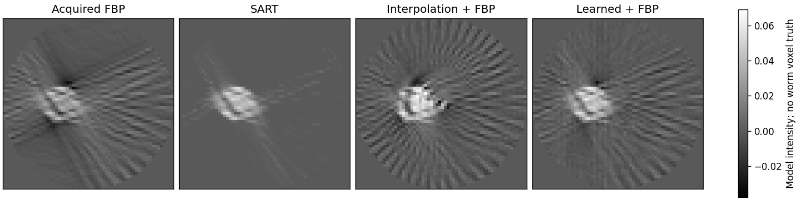
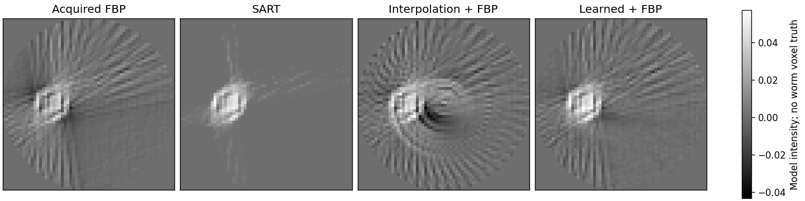

# Completion-to-reconstruction bridge — 16 November 2026

User authorization superseded the quota stop; personal quota remains unknown.
No cleanup or installation occurred. The 250 MiB artifact limit remained active.
Starting commit 26cf9d6; existing uncommitted differentiable-FBP work preserved.

## Prospective design and execution

CPU-only, original V3 25×62 grid and eight separate axial planes. One frozen
Arm B checkpoint (seed 2026102901), hash checked against its saved report;
strict architecture loading confirms 5809 parameters. These are single-checkpoint
results, not V3 seed means. Original normalization/noise schedule reused.

First three selection deformations: worm153/204/207. New starts 64.8° and136.8°
with acquired span90°, plus64.8°/120° control. All Boolean masks are absent from
V3 training, selection AND audit inventories. Deformations have previous selection
exposure. Acquisitions are new; these are not unseen organisms.

The runner wrote protocol.json before calibration or outcome access. Reconstruction
uses62×62 pixels at5 µm, detector centres -152.5:5:152.5 µm, circular support,
u=x cos(theta)-y sin(theta), 7.2° weights (no pi/span gain), and five SART sweeps
with relaxation0.5. Full-grid FBP for both completion arms is identical. Measured
values are copied bitwise from one canonical FP64 observation per case.

Prospective thresholds: at least2 percentage points lower withheld reprojection
error, majority of deformations improving, at most1 point worse acquired residual.
SART competitiveness: within2 withheld points and1 acquired point. First comparison
passes versus interpolation on all3 deformations and is competitive with SART.
Following that branch, no Stage3 training was launched.

The additional protocol was frozen AFTER the first gate, before its own outcomes:
next three selection files worm292/293/294, new172.8°/90° and136.8°/120° masks.
This timing is explicit; additional outcomes did not tune the checkpoint or method.

## Narrow-mask results

All values are relative-L2 percentages. Average eight slices jointly per mask,
then masks within deformation, then deformations equally. Acquired RMSE is also
in the CSV, alongside the known normalized noise SD0.05. No zero denominator occurred.

| Set | Arm | Raw completion | Reprojection withheld | Acquired residual |
|---|---|---:|---:|---:|
| Primary | Acquired FBP | — |84.88|32.51|
| Primary | SART | — |36.80|15.55|
| Primary | Interpolation + FBP |67.70|67.86|13.90|
| Primary | Learned + FBP |38.05|36.84|13.57|
| Additional | Acquired FBP | — |84.54|32.92|
| Additional | SART | — |37.39|16.12|
| Additional | Interpolation + FBP |76.76|76.83|15.61|
| Additional | Learned + FBP |52.07|44.30|17.70|

The completion benefit survives FBP relative to interpolation. However, the
additional case set fails the acquired-residual tolerance versus interpolation
(+2.09 points), and fails SART competitiveness (+6.91 withheld, +1.57 acquired).
Thus the initial simple positive result does not validate uniformly across the
additional acquisition/deformation conditions. Deformation and mask changes are
confounded. The moderate controls remain in the per-case CSV; narrow masks alone
define the primary gate. This is a mixed result, not a voxel-accuracy claim.




Common intensity ranges within each panel; brightness is not accuracy. Worm voxel
truth is absent. Physical scaling against the original simulator remains unverified.

## Checks, limits and stopping

Shifted anisotropic synthetic calibration: full-angle FBP error5.10%, scale0.9794;
adjoint relative error9.6e-14. Prospective tolerances were15%,10% scale error and
1e-11 respectively. Reversal under180° and repeated SART equality pass. The existing
small synthetic differentiable-FBP test passes forward-reference agreement,
lambda-zero identity and gradient/copy isolation. Both saved fixtures independently
regenerate reprojection metrics; primary learned predictions regenerate from observed
inputs alone. These checks do not establish sparse-grid phantom restoration benefit:
no learned phantom arm was scored because worm-trained scale/distribution transfer
has not been validated. No learned voxel-accuracy claim is made.

No GPU experiment, new training, posterior sampling or Gaussian fit was performed.
Stage3 remains unexecuted: the initial gate chose additional validation, whose mixed
result is reported without retroactively switching branches. A new prospective
training ablation would need separate selection/evaluation masks and a training-only
lambda freeze. Optional disagreement analysis was skipped after the additional
validation failed. Reserved24 outcomes remain sealed.

| Stage | Status |
|---|---|
| Workspace/checkpoint/calibration | Completed for this small CPU comparison |
| No-training primary bridge | Completed; passes interpolation gate and SART competitiveness |
| Additional validation | Completed; fails residual and SART competitiveness gates |
| Conditional training | Gated off by initial branch; not run |
| Disagreement | Skipped following mixed validation |

The source preparation note remains historical. DuDoNet primary-source requests
returned403; its full methods inspection remains incomplete. The tested bridge
uses existing V3 inference and FBP, without borrowing a new loss in training.
[DuDoNet](https://openaccess.thecvf.com/content_CVPR_2019/papers/Lin_DuDoNet_Dual_Domain_Network_for_CT_Metal_Artifact_Reduction_CVPR_2019_paper.pdf).
See [V3 protocol](ACQUISITION_DIVERSITY_V3.md) and
[ICECREAM results](ICECREAM_RESULTS_V1.md) for historical contexts; their different
grids/noise protocols prohibit direct score comparisons.

## Reproduction

Use the existing isolated environment, one CPU thread, fresh destinations:

```bash
export PYTHONDONTWRITEBYTECODE=1 OPENBLAS_NUM_THREADS=1 OMP_NUM_THREADS=1
PY=output/worm_uncertainty/alternative_reconstruction_sources/env/bin/python
$PY -m experiments.worm_uncertainty.studies.reconstruction_bridge --root output/worm_uncertainty/bridge_repeat_primary
$PY -m experiments.worm_uncertainty.studies.reconstruction_bridge --root output/worm_uncertainty/bridge_repeat_additional --additional
```

Each run has a600-second elapsed cap; fixtures replace full-volume dumps. Both
protocols, per-case CSVs, summary timing/bytes and compact panels are preserved in
`docs/results/worm_uncertainty/reconstruction_bridge_v1/`. Ignored run directories
retain scored fixtures and executed runner snapshots. No files were committed or pushed.
