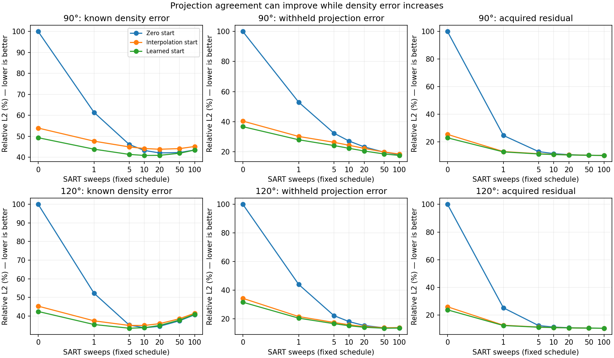
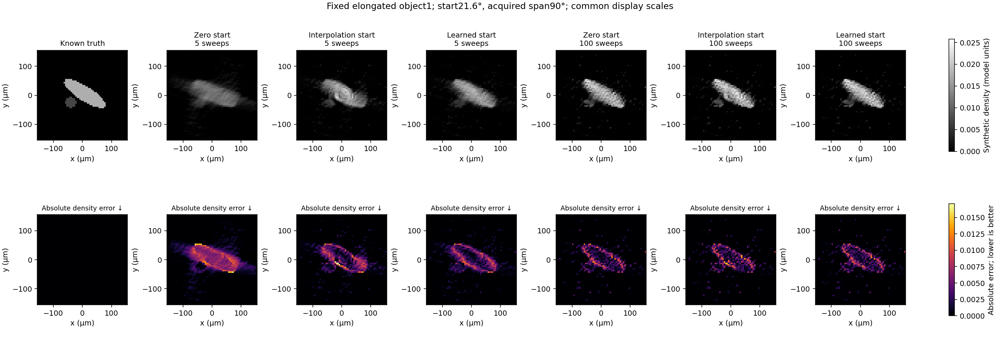

# Week 8 — longer matched SART control, 16 November 2026

## Result and decision

The learned initialization's **density advantage nearly disappears relative to
zero-start SART at the fixed100-sweep endpoint**. At90° acquired coverage, its
4.74-percentage-point gain at five sweeps shrinks to0.03 points at100 sweeps.
The frozen2-point persistence gate fails against both zero and interpolation
initialization. No training or further iteration extension was launched.

This revises the interpretation of the preceding positive pilot: it demonstrated
an early-budget advantage. This follow-up does not establish a superior terminal
reconstruction or prove asymptotic convergence. All216 object/mask/arm cases fail
the prospectively declared stability diagnostic at100 sweeps.

## Frozen comparison

The [versioned protocol](../protocols/sart_duration_v1.json) was saved before
new outcomes. The parent known-density benchmark is
[PHANTOM_DENSITY_RESULTS_V1.md](PHANTOM_DENSITY_RESULTS_V1.md). Its12 evaluation
objects, six acquisition masks, noisy observations and completed sinograms are
reused by hash. These objects have already been evaluated; this is a development
control, not an untouched test. No new worm file, reserved deformation, network
training or noise realization was used.

Three initializers: zero density, interpolation+FBP, learned+FBP. The two FBP
initializers are recomputed from saved full-grid completions, then clamped
nonnegative inside identical support. Each receives precisely the same acquired-only
SART schedule, relaxation0.5, angle ordering and nonnegative/circular constraints.
Predicted missing rays influence initialization only. Geometry and scales remain
62×62 pixels at5µm,25 angles0:7.2:172.8°,62 point detectors at5µm.

Reported sweep budgets are0,1,5,10,20,50,100;100 is the primary endpoint.
Sweep99 is retained internally only for the last-sweep update diagnostic.
No truth- or withheld-based iteration selection occurs. Every five-sweep metric
must reproduce the original benchmark before accepting later results; this passes.
Equal SART sweeps match refinement effort, not total learned-method cost: the
network's historical training and inference are additional work.

The prospectively frozen gate is at least2 points lower density error, improvement
on a majority of12 objects, and acquired residual at most1 point worse. The primary
90° group averages its three orientations within each object, then objects equally.
The120° group is a secondary control. Views and repeated masks are not independent
specimens. The fixed100-sweep outcome is reported even when earlier density error
was lower; no new stopping rule is fitted to these evaluation curves.

## Density and projection results

All relativeL2 values are percentages; lower is better.

| 90° coverage | Zero start density | Interpolation start density | Learned start density | Zero acquired residual | Learned acquired residual |
|---|---:|---:|---:|---:|---:|
| 5 sweeps |46.10|44.94|41.37|12.97|11.24|
| 10 sweeps |43.24|44.17|40.86|11.47|10.82|
| 20 sweeps |42.07|43.82|40.92|10.73|10.51|
| 50 sweeps |42.25|44.13|41.91|10.31|10.27|
| **100 sweeps: primary endpoint** |**43.47**|**45.14**|**43.44**|**10.18**|**10.16**|

At100 sweeps, learned start improves density by only0.03 points versus zero start
(9/12 object wins) and1.70 points versus interpolation start (10/12 wins).
The majority condition passes but the required mean gain does not. Small wins on
many cases do not establish a practically useful effect under the frozen gate.

| 100-sweep endpoint | Density error | Withheld error | Acquired residual | Boundary distance (µm) |
|---|---:|---:|---:|---:|
| 90°, zero |43.47%|18.02%|10.18%|5.80|
| 90°, interpolation |45.14%|18.39%|10.18%|5.85|
| 90°, learned |43.44%|17.45%|10.16%|5.79|
| 120°, zero |40.67%|13.52%|10.62%|4.45|
| 120°, interpolation |41.49%|13.77%|10.61%|4.47|
| 120°, learned |40.90%|13.47%|10.61%|4.46|

At120°, learned start is0.23 points worse than zero start and improves only3/12
objects relative to it. The initial gain is not robust to the longer schedule.

The90° learned-start boundary distance worsens4.36→5.79µm from five to100 sweeps.
Its withheld projection error improves24.05%→17.45% over the same interval, while
known density error worsens41.37%→43.44%. At120°, the analogous density change is
33.42%→40.90%, despite lower acquired and withheld errors. Improved projection
prediction or data fit therefore does not guarantee improved reconstructed density.

### Object-class outcomes

| Class (three objects),90° at100 sweeps | Zero density error | Learned density error |
|---|---:|---:|
| Smooth |51.04%|50.58%|
| Elongated |31.68%|31.29%|
| Shell |55.44%|55.12%|
| Heterogeneous |35.72%|36.77%|

Gains are small in the first three class means, and heterogeneous density regresses.
Shells remain the least accurate class. This small shared-generator benchmark does
not isolate anatomical generalization or imply independent-organism transfer.



*Every planned sweep budget is shown; horizontal positions use a logarithmic scale
above one sweep. Lower error is better. Density error can turn upward while the
projection scores keep improving. These curves did not select a new checkpoint.*



*Prospectively fixed elongated object1, start21.6°/span90°. Common density/error
scales reveal residual structure errors and loss of the clear early-start advantage.
The exact synthetic density, rather than a surrogate reconstruction, supplies truth.*

## Stability and interpretation limits

Two diagnostics were declared per object/mask/arm: last-sweep relative iterate
change at most1e-4 and relative acquired-residual change between50 and100 sweeps
at most1e-3. **0/216 cases pass both.** Median last-sweep changes are about0.13%
and median50-to100 residual changes about0.73–0.89%, above these tolerances.
This is an assessment of finite-run stability, not stationarity certification or
a proof that all initializers converge to the same density.

Across both spans, learned-start and zero-start terminal densities still differ
by about5.03% on average relative to zero-start density norm. Their acquired
projections differ by only0.17% relative to observed norm. Similar data fit can
coexist with different densities; these diagnostics do not identify a posterior
or prove that a particular structure is trustworthy.

The error curves are consistent with late iterations amplifying noise and weakly
constrained density components, but this run does not separate those causes.
The fixed noise level, simple shared generator classes, matched discrete forward
model, one network seed and previously evaluated objects remain limitations.
No physical worm-density,3D morphology or calibrated uncertainty claim follows.

## Checks, resources and exact commands

The complete sweep schedule was independently replayed and all1512 metric rows
regenerated. Verification checks parent/source hashes, checkpoint-linked parent
arrays, acquired/initializer hashes, five-sweep historical parity, saved5/100
solutions, positivity/support, object-first aggregates and frozen gain decisions.
New continuation tests verify that chunking1+4+5+10 sweeps is bitwise identical to
20 sweeps, and poisoning withheld inputs cannot change measured-only refinement.

The full experiment suite passed108 tests in4.76 seconds; formatting/lint passed
across150 Python files, and local documentation links and diff whitespace checks pass.

CPU execution took6.08 seconds on liet, one BLAS thread; no GPU or training work.
New run artifacts occupy4,177,691 bytes, below the15MiB cap. Week8 ignored run
artifacts total13,574,847 bytes before report exports, well below250MiB. Personal
quota remains unknown under the user's explicit waiver; nothing was removed,
relocated or installed. All outputs are fresh; the parent is unchanged.

Verify existing artifacts (about10 CPU seconds including interpreter overhead):

```bash
cd ~/espaces/travail/trdp2/r2_gaussian
export PYTHONDONTWRITEBYTECODE=1 OPENBLAS_NUM_THREADS=1 OMP_NUM_THREADS=1
export MPLCONFIGDIR=/tmp/cache-mdzislam/matplotlib
PY=output/worm_uncertainty/alternative_reconstruction_sources/env/bin/python
$PY -m experiments.worm_uncertainty.studies.verify_sart_duration
$PY -m unittest experiments.worm_uncertainty.tests.test_sart_duration \
  experiments.worm_uncertainty.tests.test_phantom_density
```

Optional exact reproduction, fresh destination (120-second ceiling; normally
seconds, no training):

```bash
$PY -m experiments.worm_uncertainty.studies.sart_duration \
  --root output/worm_uncertainty/sart_duration_v1_reproduction
$PY -m experiments.worm_uncertainty.studies.verify_sart_duration \
  --root output/worm_uncertainty/sart_duration_v1_reproduction
```

Use `plots.plot_sart_duration --root NEW_RUN --output NEW_DIRECTORY` under the
`experiments.worm_uncertainty` package to export plots without overwrite.

## Stopping and smallest next step

This bounded duration control is complete. The practical density-advantage gate
fails at the declared terminal budget, and the stability diagnostics do not justify
calling the reconstructions converged. No further sweeps are automatically launched.

The next candidate is a noise-informed early-stopping rule developed on separate
selection phantoms, then frozen and checked on fresh objects/noise. It should be
compared for all initializers, with measured-data-only stopping and known density
used only for held-out scoring. This is a proposed protocol, not an executed result.
It would address the observed deterioration without selecting the best iteration
from these evaluation truth curves or treating more iterations as intrinsically
better. Larger networks and a new uncertainty model are not justified by this run.
